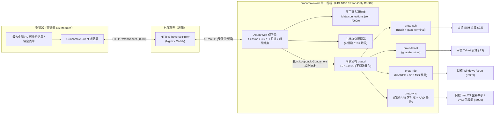

#  cracamole

> **無 Java、單一執行檔、內嵌私有協定引擎的瀏覽器遠端連線工作台（SSH / Telnet / RDP / VNC）**

`cracamole`（**Crab** 🦀 + **Guacamole** 🥑）是以純 Rust 重新設計與實作的無客戶端遠端存取系統，致敬開源遠端桌面先驅 **[Apache Guacamole™](https://guacamole.apache.org/)**。第一版聚焦於**單一管理員**的高效日常運維：提供管理員驗證、連線設定本機保存（新增／編輯／刪除），以及直接在瀏覽器中操作 **SSH、Telnet、RDP（Windows 遠端桌面）與 VNC（含 macOS 螢幕共享）**。

整套系統延續了 Apache Guacamole 優雅的「串流指令協定（Guacamole Protocol）」與前端畫布渲染理念，同時**完全移除 Java、Tomcat、Maven、外部資料庫與前端打包工具鏈**：前端靜態資產（HTML / CSS / 原生 ES Modules）於編譯期直接封裝進 `cracamole-web` 單一執行檔，並在同行程內啟動僅綁定私人 loopback（`127.0.0.1:0`）的 Guacamole 協定 daemon。對外只暴露單一 HTTP / WebSocket 服務埠。

---

## 架構設計筆記（Architecture Overview）



### 1. 為什麼採用「單一執行檔＋內嵌私人 Loopback Daemon」？
傳統 Apache Guacamole 需要同時維運 Tomcat（Java WebApp）、`guacd`（C daemon，預設監聽 4822 埠）與外部關聯式資料庫，不僅映像體積龐大，且一旦 4822 埠誤對外暴露，任何能連上 `guacd` 的來源都可在未經 Web 驗證下發起遠端連線。

在 `cracamole` 中：
- **零外部協定埠暴露**：`cracamole-web` 啟動時向作業系統申請 `127.0.0.1:0` 隨機埠啟動內嵌 `guacd` 任務，不提供任何對外 TCP 監聽。所有 WebSocket tunnel 升級皆必須先通過 Web 層的 Cookie Session 與同源（Same-Origin）檢查，並由伺服器端直接從本機設定庫注入機密參數，瀏覽器永遠拿不到連線密碼或私鑰。
- **零執行期外部依賴**：前端採用原生 ES Modules 與 CSS Design Tokens（`web/`），由 `include_bytes!` 直接編入執行檔，並由單元測試（`every_web_file_is_served`）強制確保所有靜態檔皆有對應路由。正式環境不需要 Node.js（Node 僅用於開發期執行 Playwright E2E 與無障礙／對比度測試）。

### 2. Workspace 模組分層（13 Crates）
依賴方向嚴格由上往下，底層協定與顯示引擎絕不反向依賴 Web 層：

| Crate | 職責與架構邊界 |
|---|---|
| `cracamole-web` | **系統正式部署入口**。提供 Axum HTTP/WebSocket 服務、Argon2id 管理員驗證、連線 CRUD、SSH/RDP 主機身分探測、內嵌靜態資產與私人 loopback `guacd` 生命週期管理。 |
| `cracamole-store` | Web 與開發中的 Windows 原生介面共用的管理員帳密驗證、連線設定驗證與保存。 |
| `cracamole-desktop` | 開發中的 Windows 原生介面；目前提供登入、基本連線新增／編輯／刪除、隨視窗調整的遠端畫面、輸入區、基本滑鼠及文字剪貼簿。原生系統剪貼簿、完整鍵鼠、真實 RDP 服務與可見畫面仍未完成驗收。登入使用 `CRACAMOLE_ADMIN_USERNAME`／`CRACAMOLE_ADMIN_PASSWORD`；桌面資料獨立保存於 `%LOCALAPPDATA%\cracamole-desktop`，可用 `CRACAMOLE_DESKTOP_DATA_DIR` 指定其他**專用目錄**。工作階段預設八小時；可用 `CRACAMOLE_DESKTOP_SESSION_MAX_SECS` 設定 1 至 28800 秒的較短期限。 |
| `guacd` | Guacamole 線路協定路由與外掛註冊表（`Registry`）。可獨立執行以供相容性測試，但**非**完整 Web 系統入口。 |
| `proto-ssh` | 純 Rust SSH 客戶端（基於 `russh`），支援密碼、OpenSSH/PEM 私鑰與密語、嚴格 `known_hosts` 驗證（含 `@revoked` 撤銷檢查）、PTY 動態縮放、雙向剪貼簿與安全貼上過濾。 |
| `proto-telnet` | Telnet 狀態機與自動登入提示字元（正規表示式）比對，共用 `guac-terminal` 渲染管線。 |
| `proto-rdp` | 純 Rust RDP 引擎（基於 `IronRDP`），提供遠端桌面畫面、鍵盤、滑鼠、雙向文字剪貼簿、瀏覽器視窗動態縮放（Display Control DVC）與伺服器憑證 SHA-256 指紋釘選。 |
| `proto-vnc` | 純 Rust VNC（RFB 3.3／3.7／3.8）客戶端，**以連線 macOS 螢幕共享為優先**：支援 Apple Remote Desktop 驗證（安全類型 30，Diffie-Hellman＋AES-128＋MD5，帳號加密碼）與傳統 VNC 密碼（安全類型 2），編碼 Raw／CopyRect／Hextile／ZRLE，伺服器端桌面尺寸變更（DesktopSize／ExtendedDesktopSize）、鍵盤、滑鼠、雙向文字剪貼簿（ISO 8859-1 或 UTF-8），並對惡意伺服器設有尺寸、記憶體與解壓縮上限。 |
| `guac-terminal` | 終端機模擬器（整合 `alacritty_terminal` 與 `fontdue`），內建共享字型快取、單一 CJK fallback、髒矩形（dirty-region）合成、最小格點與字型配置上限防護。 |
| `guac-display` | 圖層與表面（Surface）髒矩形追蹤、PNG 編碼與畫格批次發送器。 |
| `guac-session` | 單一連線工作階段之讀寫迴圈、閒置心跳（`nop`/`sync`）與優雅關閉控制。 |
| `guac-protocol` | Guacamole 線路指令（`len.content,len.content;`）零配置／串流解析器與編碼器，具備嚴格元素長度上限。 |
| `guac-testkit` | 測試專用輔助庫（僅作為 `dev-dependency`）。 |

Windows 原生版使用獨立資料目錄，不會自動讀取或遷移 Web 版連線；不得將桌面目錄與 Web 的 `CRACAMOLE_DATA_DIR` 設為同一目錄，因兩者尚未協調跨程序寫入。桌面版僅接受擁有者及 ACL 符合要求的私有目錄與檔案；機密仍以明文保存。「核對身分」可探測 SSH 金鑰或 RDP 憑證，供使用者經可信管道核對後保存；既有信任不符時不會自動取代。Windows 自動化以本機 SSH 伺服器及 TLS 模式 Rust RDP 測試伺服器驗證指紋、帳密、影格與輸入；已在 Windows x64 可見桌面比對 RDP 測試影格於縮放前後各九個像素。真實 Windows／xrdp 服務、NLA、其他畫面內容及更廣泛的可見畫面仍待端對端驗收。

若有設定 `CRACAMOLE_DESKTOP_SESSION_MAX_SECS`，其值必須是 1 至 28800 的整數；無效值會使程式顯示錯誤並以非零狀態結束，避免誤用較長的預設期限。未設定時使用八小時。Windows x64 自動化已確認錯誤訊息、結束碼及不建立桌面資料目錄。

SSH 自動化亦驗證中文及 UTF-16 代理對輸入可送達遠端；Windows x64 可見桌面已取樣測試終端機的文字及背景。Windows 輸入法的組字操作仍需實機驗收。

Windows x64 的本機 Telnet fixture 另驗證原生視窗新增連線、接收影格、中英文輸入、登出或工作階段到期後伺服器在視窗關閉前收到 EOF，以及遠端主動結束時更新狀態並清除舊影格；預設使用隱藏視窗，未檢查螢幕合成畫面或實體輸入裝置。可在有互動桌面的工作階段使用下列命令取樣可見的測試文字與背景；測試短暫顯示自己的視窗而不切換焦點，並先確認取樣位置屬於測試程序。最近一次此可見測試及既有 SSH 可見測試在同一 RDP 工作階段均未偵測到預期像素；後續診斷顯示該工作階段的螢幕 `GetPixel` 在測試視窗及螢幕原點均回傳失敗，無法完成取樣，不能將失敗視為可見畫面通過或據此判定畫面渲染異常。

```powershell
$env:CRACAMOLE_TEST_VISIBLE_TELNET = '1'
cargo test -p cracamole-desktop --test windows_telnet --locked native_telnet_connect_input_and_logout -- --exact --nocapture
Remove-Item Env:CRACAMOLE_TEST_VISIBLE_TELNET
```

後續重測時螢幕原點的 `GetPixel` 可讀取，但 Telnet 可見測試仍失敗，最後回報測試影格的 `GetWindowRect` 失敗；SSH 可見測試確認取樣點屬於測試程序後，該點的 `GetPixel` 回傳失敗，故未能檢查文字。這些結果不足以確定畫面是否正確，仍需在可互動的桌面重新驗證。

顯示環境的額外診斷回報主螢幕、虛擬桌面與螢幕裝置環境均為 2560×1440，但螢幕座標 (34, 161) 即使位於此範圍內，`GetPixel` 仍回傳失敗；可見測試不能僅憑原點讀取成功就視為環境可用。

遠端輸入區會接收 Tab 等對話框導覽鍵，並支援 Ctrl 加字母、數字及鍵盤配置對應的符號鍵。Windows 自動化已驗證 Tab、Ctrl+2、Ctrl+3；Ctrl+[ 僅在該按鍵配置對應左方括號時驗證。

遠端輸入區失去焦點時會立即釋放追蹤中的特殊鍵、控制組合鍵與修飾鍵，並保留定時檢查作為後備，降低切換視窗後遠端按鍵停留在按下狀態的機會。Windows x64 自動化以原生視窗訊息模擬 Ctrl+A、左方向鍵與失焦，確認本機 RDP 測試伺服器收到按下及放開事件；同步重入後的重試亦已測試，實體鍵盤操作仍待驗收。

對使用 Ctrl 加右 Alt 表示 AltGr 的鍵盤，原生介面會暫時解除傳給遠端的 Ctrl，讓輸入文字不被誤當成控制字元；此路由已以鍵盤狀態及共用終端機測試，實體 AltGr 鍵盤配置仍待驗收。

原生滑鼠座標依實際顯示的影格大小換算；影格置中或裁切時，留白不會當成遠端點擊，拖曳與放開會限制在可見範圍。Windows 收回滑鼠捕捉時會釋放遠端按鍵。自動化以隱藏的 Windows 控制項繪製到記憶體裝置環境，核對置中及裁切座標；完整實體滑鼠及可見合成畫面仍待驗收。

在 Windows 安裝 Rust 與 MSVC 建置工具，並在啟動程式的環境中設定至少 12 字元的 `CRACAMOLE_ADMIN_PASSWORD`；`CRACAMOLE_ADMIN_USERNAME` 可省略，預設為 `admin`。在 repository 根目錄執行：

```powershell
cargo run -p cracamole-desktop --locked
```

也可建置 Windows x64 的最佳化執行檔：

```powershell
cargo build -p cracamole-desktop --release --locked
& '.\target\release\cracamole-desktop.exe'
```

啟動執行檔前同樣須在該程序環境中設定管理員密碼。Windows x64 本機已以 release 執行檔測試錯誤設定、登入與連線管理、Telnet，以及 loopback fixture 的 RDP TLS／NLA；這不代表已完成真實遠端服務或實體輸入的驗收。

目前的 MSVC release 執行檔動態依賴 Windows 系統程式庫、通用 C runtime 與 `VCRUNTIME140.dll`。目標電腦須具備版本不舊於建置工具的 [Microsoft Visual C++ x64 Redistributable](https://learn.microsoft.com/en-us/cpp/windows/latest-supported-vc-redist/)；不要單獨從非官方來源下載 DLL。尚未在全新安裝的 Windows 上驗證部署。

若要另行建置靜態連結 CRT 的 Windows x64 版本，可使用獨立目錄，避免覆蓋上述執行檔：

```powershell
$previousRustFlags = $env:RUSTFLAGS
try {
    $env:RUSTFLAGS = '-C target-feature=+crt-static'
    cargo build -p cracamole-desktop --release --locked --target-dir target/windows-static
    if ($LASTEXITCODE -ne 0) { throw '建置失敗' }
} finally {
    if ($null -eq $previousRustFlags) { Remove-Item Env:RUSTFLAGS -ErrorAction SilentlyContinue }
    else { $env:RUSTFLAGS = $previousRustFlags }
}
& '.\target\windows-static\release\cracamole-desktop.exe'
```

本機建置的靜態 CRT 版本，其 PE 直接匯入表沒有 `VCRUNTIME140.dll` 或通用 CRT DLL，仍需 Windows 系統程式庫；已在 Windows x64 測試啟動、登入／Telnet、本機 SSH 的密碼／私鑰及 Big5，與本機 RDP TLS／NLA fixture。尚未在乾淨安裝的 Windows 驗證，不能排除其他動態載入需求。

可使用下列方式，讓原生 SSH 自動化改測指定的已建置執行檔：

```powershell
$env:CRACAMOLE_TEST_DESKTOP_BINARY = (Resolve-Path 'target/windows-static/release/cracamole-desktop.exe').Path
cargo test -p cracamole-desktop --test windows_ssh --locked
Remove-Item Env:CRACAMOLE_TEST_DESKTOP_BINARY
```

選取 SSH 或 RDP 連線後，可先按「核對身分」，透過其他可信管道比對指紋再確認保存。RDP 可設定網域及安全模式，預設使用 NLA；TLS 或自動協商須明確選擇。SSH 私鑰登入可在連線編輯畫面填入私鑰檔案路徑與密語；私鑰須是最多 8192 位元組的 UTF-8 文字。編輯時若協定、主機、連接埠及安全設定不變，未填入的機密會保留，勾選清除可移除；變更上述設定時須重新提供機密。檔案內容與密語保存於桌面連線庫，並非靜態加密。這是開發中版本，尚未完成下述原生介面驗收。

SSH／Telnet 可選擇 UTF-8、Big5 等核心支援的終端機編碼。Telnet 可設定登入成功與失敗的正規表示式，兩者須同時填寫；留空則不等待登入結果。連線可設為唯讀，禁止送出遠端輸入；視窗會顯示唯讀狀態並停用輸入區。RDP 另可分別禁止從遠端複製及貼到遠端。這些限制由共用協定核心執行。

原生貼上會在背景讀取系統剪貼簿，逾十秒未完成即放棄這次貼上；登出或中斷連線後不會將延遲返回的內容送到其他連線。連線設定禁止貼上或設為唯讀時，貼上按鈕會停用，且不啟動剪貼簿讀取。若 Windows 仍在等待剪貼簿提供者，需等該次系統讀取結束才能再試。

遠端複製文字寫入 Windows Unicode 剪貼簿前會將換行轉為 CRLF，並檢查轉換後的大小上限；過大的內容會拒絕寫入。

系統剪貼簿讀寫測試只在成功建立全新的隔離視窗站後執行，否則顯示 `SKIP`。驗收環境可設定 `CRACAMOLE_REQUIRE_ISOLATED_CLIPBOARD=1`，使無法建立隔離環境時測試失敗，而非把跳過誤認為通過：

```powershell
$env:CRACAMOLE_REQUIRE_ISOLATED_CLIPBOARD = '1'
cargo test -p cracamole-desktop --bin cracamole-desktop windows_clipboard::tests::isolated_windows_clipboard_round_trip --locked -- --exact --nocapture
Remove-Item Env:CRACAMOLE_REQUIRE_ISOLATED_CLIPBOARD
```

目前這個 Windows 工作階段的自動命名視窗站已存在；測試再嘗試建立唯一名稱的視窗站時，目前程序權限被拒絕，因此嚴格隔離測試會失敗。具備建立命名視窗站權限的驗收環境可重新執行；測試只接受新建的視窗站，不會使用已存在的站台。下列互動測試已在 Windows x64 執行一次並通過，確認本機 Unicode 文字讀寫；尚未驗證透過原生介面與真實遠端 RDP 的剪貼簿交換。

若無法建立隔離環境，也可在**已確認目前剪貼簿內容可以丟棄**的互動工作階段手動執行下列測試。它會將剪貼簿原有全部格式覆蓋成固定的 `cracamole 剪貼簿測試🙂` 兩行文字，然後讀回；無法保證還原原內容。測試預設忽略，且必須明確設定環境變數才會執行：

```powershell
$env:CRACAMOLE_ALLOW_INTERACTIVE_CLIPBOARD_TEST = '1'
cargo test -p cracamole-desktop --bin cracamole-desktop windows_clipboard::tests::interactive_windows_clipboard_round_trip --locked -- --ignored --exact --nocapture
Remove-Item Env:CRACAMOLE_ALLOW_INTERACTIVE_CLIPBOARD_TEST
```

另有原生視窗與本機 RDP fixture 的系統剪貼簿往返測試。它會在連線時把互動工作階段的剪貼簿全部格式覆蓋為固定兩行文字 `遠端測試🙂`、`第二行`，然後按下原生介面的「貼上」傳回只監聽 loopback 的 fixture；不保證還原。fixture 只保存吻合或不吻合的標記，不保存剪貼簿內容，這項限制已用固定模擬資料經本機 NLA 連線驗證。測試會先確認剪貼簿擁有者屬於測試程序，但其他應用程式仍可能在確認後變更剪貼簿。Windows x64 已經使用靜態 CRT 執行檔及本機 NLA fixture 完成此系統剪貼簿往返；真實遠端服務的交換仍待驗收。僅在內容可以丟棄時執行，且須明確設定環境變數：

```powershell
cargo build --manifest-path tests/rdp-fixture/Cargo.toml --target-dir target/rdp-fixture --locked
$env:CRACAMOLE_ALLOW_INTERACTIVE_RDP_CLIPBOARD_TEST = '1'
try {
    & 'crates/cracamole-desktop/tests/windows_rdp_full.ps1' -Binary (Resolve-Path 'target/windows-static/release/cracamole-desktop.exe').Path -Fixture (Resolve-Path 'target/rdp-fixture/debug/cracamole-rdp-fixture.exe').Path -Nla -InteractiveClipboard
} finally {
    Remove-Item Env:CRACAMOLE_ALLOW_INTERACTIVE_RDP_CLIPBOARD_TEST -ErrorAction SilentlyContinue
}
```

Windows x64 另以本機 Rust SSH fixture 和專用 loopback Web 服務，使用 Chromium 驗證瀏覽器合成的終端機畫面、按鍵傳送，以及使用者中斷時 WebSocket 正常關閉碼 1000。重跑前須在 `tests/e2e` 安裝 Playwright 相依套件和 Chromium，並啟動使用獨立資料目錄、測試帳號 `admin`／`fixture-admin-password-2026` 的本機 Web 服務；設定 `CRACAMOLE_URL` 指向該服務後執行：

```powershell
cargo test -p cracamole-desktop --test windows_ssh --locked browser_shared_ssh_composited_terminal -- --ignored --exact --nocapture
```

測試會在指定的 Web 服務新增測試連線，請勿指向正式服務。

在 Windows 驗證本機 RDP 測試伺服器與原生介面，可依序執行下列命令。fixture 使用獨立鎖定檔及隨機測試憑證，不需修改系統 RDP 服務；測試包含拒絕不符的憑證指紋、拒絕錯誤密碼、影格、輸入、驅動層雙向 Unicode 剪貼簿，以及分別停用複製或貼上的設定。這組 RDP 測試使用固定測試文字，不讀寫 Windows 系統剪貼簿；實際遠端剪貼簿交換仍待驗收。`rdp_live` 預設標記為 ignored，必須明確指定執行：

Windows x64 也已使用本機 fixture 的 NLA／CredSSP 模式驗證不符指紋與錯誤密碼遭拒、成功認證後的影格與按鍵，以及尺寸重新協商後驅動層的雙向 Unicode 剪貼簿、禁止複製／貼上及唯讀限制；原生視窗另驗證認證、畫面、縮放、輸入及關閉。這使用獨立 Rust 測試伺服器，未使用系統剪貼簿；真實 Windows／xrdp 的 NLA 互通性與遠端系統剪貼簿交換仍待驗收。

驅動層及 Windows x64 原生視窗的「自動協商」亦分別對僅支援 TLS 和僅支援 NLA 的本機 fixture 測試，確認設定保存、憑證釘選後可收到畫面並關閉連線。

原生視窗測試另以連續變化的影格觀察 GDI 物件數，確認多次更新後未出現明顯增長；這是短時間資源回歸檢查，不代表已完成長時間穩定性驗收。

可另在有互動桌面的 Windows 工作階段，於最後一行加上 `-VisiblePixelCheck`；測試會短暫顯示視窗而不切換焦點，確認取樣位置屬於測試程序後，分別比對縮放前後各九個螢幕像素，不保存截圖。此檢查不涵蓋整張畫面或各種顯示環境。

本機 RDP 測試也核對連續調整視窗後，伺服器收到與原生影格控制項一致的最終尺寸、視窗替換點陣圖且仍可送出按鍵；另在驅動層模擬放大再縮小時的重新協商、回傳不同顏色的新尺寸畫面及驗證後續雙向剪貼簿傳輸。遠端複製使用調整後才產生的新文字；停用複製、停用貼上及唯讀限制也在重新協商後檢查。這些測試不取代真實 Windows／xrdp 端點的驗收。

```powershell
cargo build --manifest-path tests/rdp-fixture/Cargo.toml --target-dir target/rdp-fixture --locked
cargo build -p cracamole-desktop --locked
$env:CRACAMOLE_RDP_FIXTURE = (Resolve-Path 'target/rdp-fixture/debug/cracamole-rdp-fixture.exe').Path
cargo test -p cracamole-desktop --test rdp_live --locked -- --ignored
& 'crates/cracamole-desktop/tests/windows_rdp_full.ps1' -Binary (Resolve-Path 'target/debug/cracamole-desktop.exe').Path -Fixture $env:CRACAMOLE_RDP_FIXTURE
& 'crates/cracamole-desktop/tests/windows_rdp_full.ps1' -Binary (Resolve-Path 'target/debug/cracamole-desktop.exe').Path -Fixture $env:CRACAMOLE_RDP_FIXTURE -Nla
& 'crates/cracamole-desktop/tests/windows_rdp_full.ps1' -Binary (Resolve-Path 'target/debug/cracamole-desktop.exe').Path -Fixture $env:CRACAMOLE_RDP_FIXTURE -Auto
& 'crates/cracamole-desktop/tests/windows_rdp_full.ps1' -Binary (Resolve-Path 'target/debug/cracamole-desktop.exe').Path -Fixture $env:CRACAMOLE_RDP_FIXTURE -Nla -Auto
```

SSH 可見畫面另可在互動桌面執行以下測試：

```powershell
$env:CRACAMOLE_TEST_VISIBLE_SSH = '1'
cargo test -p cracamole-desktop --test windows_ssh --locked native_ssh_trust_and_connection -- --exact --nocapture
Remove-Item Env:CRACAMOLE_TEST_VISIBLE_SSH
```

測試短暫顯示自己的視窗，不切換焦點，並在確認取樣位置屬於測試程序後比對固定測試文字與背景；不保存截圖。此檢查不代表所有字型、輸入法或顯示環境均已驗收。

### 3. 介面與操作體驗設計（UI/UX Architecture）
針對系統管理員長時間操作 SSH、Telnet、RDP 與 VNC 的核心痛點，Web 前端（`web/`）與開發中的 Windows 原生桌面版（`crates/cracamole-desktop`）遵循以下工程設計（完整規範與待改善路線詳見 [`web/GUIDELINES.md`](web/GUIDELINES.md) §5.1、§11、§12）：
- **最大化遠端畫面與可收折選單**：
  - 移除頂部 Title Bar，舞台直接自視窗頂端（`y = 0`）展開；連線建立時自動收折左側連線庫，讓終端機／遠端桌面取得 **100% 視窗寬度**。
  - 連線途中若展開左側連線庫，抽屜會以**浮動覆蓋層（Overlay Drawer）**滑出，**絕不推擠舞台寬度或觸發遠端 PTY / RDP 重新縮放**。
  - 底部狀態列提供 **「最大畫面」**（收折底欄，使遠端畫布佔滿 `100vw × 100dvh`）與 **「全螢幕」**（原生 Fullscreen API）模式。
- **高密度可折疊群組與每張卡片常駐狀態（Compact Groups & Per-Card Status）**：
  - 連線庫支援依**群組（Group）**折疊／展開與高密度緊湊卡片排列（見 `web/GUIDELINES.md` §5.1、§11），大幅提升單屏可檢視的主機數量。
  - 底部狀態列、「最大畫面」右上角浮動膠囊，以及**連線庫中的每一張卡片**皆同步顯示即時連線燈號與狀態（`未連線`、`正在連線…`、`已連線`、`連線已結束`、`連線失敗` 與指紋信任狀態），斷線返回連線庫後仍保留最後一次狀態摘要。
  - 斷線或驗證失敗時，在舞台中央以半透明覆蓋層明確區分原因（找不到主機、連線逾時、驗證失敗、主機金鑰／憑證未信任或已變更），並就地提供「重新連線」或「編輯連線」。
- **過多設定的漸進式揭露（Progressive Disclosure）**：
  - 連線編輯器採用**固定標題與固定底部操作列**（`取消`、`儲存並連線`、`儲存連線` 永遠可見），基本欄位以雙欄緊湊排列。
  - 進階選項依協定（SSH / Telnet / RDP / VNC）動態切換並收折於 `<details>` 區塊中；每個折疊標題即時顯示 **「已設定 N 項 / 預設」摘要徽章**，並提供 **「全部收合」** 按鈕，避免設定過多時捲動迷航。
- **鍵盤優先與觸控輔助**：
  - 按 `/` 快速展開連線庫並聚焦搜尋框，按 `Enter` 直接連線第一筆符合的主機；在終端機內按 `Ctrl+Shift+Escape` 可脫離終端機焦點回到選單控制（避免鍵盤焦點陷阱）。
  - 行動端（390px）與觸控螢幕提供專屬輔助鍵列（`Esc`、`Tab`、單次黏滯 `Ctrl`/`Alt`、方向鍵與常用管線符號）。
- **Windows 原生桌面版商業級工作台準則（`web/GUIDELINES.md` §12）**：
  - 對標商業級遠端桌面工具（MobaXterm / Royal TS / Windows App），規劃雙欄分割工作台（左側可收折群組樹＋即時搜尋，右側緊湊工具列＋100% 畫布直連焦點隱藏密碼圓點框＋底部狀態列）、Win32 鍵鼠直覺（`Enter`/`Esc`、清單雙擊直連）、完整四協定（含 VNC）與原生私鑰檔案選擇器（`FileDialog`），並維持與 `tests/*.ps1` 自動化測試契約相容。

---

## 安全邊界與資源防護（Security & Resource Guardrails）

1. **身分驗證與工作階段管理**
   - 管理員帳號與密碼由環境變數提供，**無預設密碼**，且啟動時強制檢查密碼長度至少 **12 個字元**（不超過 256 bytes）。
   - 密碼雜湊採用 **Argon2id**（驗證併發由 Semaphore 限制，防止 CPU 耗盡攻擊）；登入端點具備依來源 IP 的速率限制（每 60 秒最多 10 次嘗試，超限回傳 `429 Too Many Requests`）。
   - Session Cookie 預設啟用 `HttpOnly; SameSite=Strict; Path=/`（8 小時有效期，儲存於記憶體，服務重啟後須重新登入）；所有狀態變更 API 與 WebSocket 升級均強制檢查 `Origin` 與 `Host` 同源。
   - **登出、Session 到期或收到 `SIGTERM` / `SIGINT` 關機訊號時，會立即透過 `CancellationToken` 中止該工作階段下所有活躍的遠端 tunnel 與主機探測任務**。
2. **主機身分驗證（TOFU 與憑證釘選）**
   - **SSH 主機金鑰**：每次連線皆嚴格比對 `host-key`（OpenSSH `known_hosts` 格式）。尚未設定時，首次連線會先阻擋並透過探測 API 取得遠端公鑰與 **SHA-256 指紋**，由管理員核對後按「信任這把主機金鑰並重新連線」寫回設定；之後金鑰不符或命中 `@revoked` 撤銷標記時一律拒絕連線，不支援的標記或損毀紀錄亦拒絕載入，**絕不靜默降級為不驗證**。
   - **RDP 伺服器憑證**：預設嚴格驗證 TLS 憑證鏈；遇到自簽憑證時會先阻擋並顯示主體、簽發者與 **SHA-256 指紋**，核對後可一鍵釘選該指紋（`server-cert-sha256`）。
   - **探測任務防護**：主機身分探測（`/host-key` 與 `/certificate`）全系統共用最多 **4 個併發額度**，整段 DNS、TCP 與協定握手強制 **10 秒逾時**，且探測過程絕不傳送遠端登入帳密。
3. **記憶體、剪貼簿與貼上安全預算**
   - **RDP 記憶體預算**：遠端回報的桌面單邊像素不得超過 `4096px`；全程序共用 **512 MiB** 的 RDP 圖形記憶體額度（涵蓋解碼圖、輸出 framebuffer 與暫存緩衝區估算），超額時直接拒絕新配置。
   - **VNC 防護**：桌面單邊同樣不得超過 `4096px`，全程序共用 **256 MiB** 的 VNC 圖形記憶體額度；所有矩形必須落在畫面內，ZRLE 解壓縮量設上限（防解壓縮炸彈），伺服器宣告的剪貼簿超過 1 MiB 時直接略過；若設定了帳密，伺服器卻只提供「無驗證」，會拒絕連線而不是降級。**VNC／ARD 只加密登入憑證，畫面與輸入不加密**，請只在受信任網路、VPN 或 SSH 通道內使用。
   - **剪貼簿與安全貼上**：每個連線最多同時 4 條剪貼簿串流、總量上限 **256 KiB**，串流閒置 15 秒即中止（超限不貼上殘缺內容）。SSH / Telnet 貼上時會過濾 `ESC` 與危險控制字元（僅保留 Tab 與換行），防止惡意剪貼簿文字突破 Bracketed Paste 邊界直接執行指令。
4. **連線設定與機密保存現況（重要）**
   - 連線設定以原子替換（`NamedTempFile` + `sync_all` + `persist`）保存於 `/data/connections.json`，Unix 目錄權限為 `0700`、檔案權限為 `0600`。
   - **機密欄位（密碼、私鑰、密語）目前於磁碟上為明文保存，尚未實作靜態加密（Encryption at Rest）**。請務必保護宿主機的 Docker volume、備份檔案與 `.env`。
   - HTTP API 永遠只回傳 `configured_secrets: ["password", ...]` 清單，**絕不回傳密碼、私鑰或密語原文**；協定、主機、連接埠及安全設定不變時，編輯連線的空白密碼欄位會保留原值，亦可明確清除；變更上述設定時不沿用未提供的機密。

---

## 部署指南（Deployment Guide）

### 1. 快速啟動（Docker Compose，本機 Loopback）

在專案根目錄建立 `.env`（已被 `.gitignore` 忽略），設定至少 12 個字元的管理員密碼：

```dotenv
CRACAMOLE_ADMIN_USERNAME=admin
CRACAMOLE_ADMIN_PASSWORD=replace-with-your-own-strong-password
```

建置並啟動正式容器：

```sh
docker compose -f docker/compose.yml up -d --build --wait
```

- 開啟瀏覽器前往 <http://localhost:8080/> 並使用上述帳密登入。
- **預設安全綁定**：`docker/compose.yml` 預設只將連接埠發布至宿主機 loopback（`127.0.0.1:8080:8080`），且**不發布任何 `guacd` 連接埠**。
- **容器強化設定**：正式映像基於 `alpine:3`（含 `font-noto-cjk` 中文字型），以非特權使用者 `UID 1000`（`cracamole`）、**唯讀根檔案系統（`read_only: true`）**、移除全部 Linux capabilities（`cap_drop: [ALL]`）、`no-new-privileges:true`、記憶體上限 `1536m` 與 `pids_limit: 128` 執行。
- **資料持久化**：連線設定儲存在 Docker 具名 volume `connections`（掛載於 `/data`）。執行 `docker compose -f docker/compose.yml down -v` 會刪除該 volume。
- **注意容器網路解析**：連線設定中的目標主機名稱是由容器內部解析，因此在容器內填寫 `localhost` 指的是容器本身，而非宿主機。

### 2. 生產環境遠端部署（搭配 HTTPS Reverse Proxy）

`cracamole-web` 本身不直接終止 TLS。需要從外部網路存取時，請將容器維持綁定在 `127.0.0.1:8080`，並在前方部署支援 WebSocket 的 HTTPS 反向代理（如 Nginx 或 Caddy），同時啟用 `CRACAMOLE_SECURE_COOKIE` 與 `CRACAMOLE_TRUSTED_PROXIES`。

#### 步驟 A：更新 `.env`

```dotenv
CRACAMOLE_ADMIN_USERNAME=admin
CRACAMOLE_ADMIN_PASSWORD=replace-with-your-own-strong-password
CRACAMOLE_SECURE_COOKIE=true
# 填入 cracamole-web 實際看到的反向代理 TCP peer IP（逗號分隔）
# 若 Nginx 跑在宿主機且透過 127.0.0.1:8080 轉發至容器，容器看到的 peer IP 通常為 Docker bridge gateway（例如 172.18.0.1）；
# 若兩者皆在宿主機原生執行，則為 127.0.0.1,::1。
CRACAMOLE_TRUSTED_PROXIES=127.0.0.1,::1
```

> **關於 `CRACAMOLE_TRUSTED_PROXIES` 與登入限流**：
> - 應用程式**只信任**列在 `CRACAMOLE_TRUSTED_PROXIES` 中的 TCP peer IP 所傳來的單一 `X-Real-IP` 標頭；若受信任代理未帶、帶了多個或格式無效的 `X-Real-IP`，請求會被拒絕（`400 Bad Request`）。
> - 來自非受信任 peer 的轉送標頭會被完全忽略；系統**不使用**容易被偽造附加的 `X-Forwarded-For`。
> - 若經由反向代理卻未設定 `CRACAMOLE_TRUSTED_PROXIES`，所有外部使用者都會被視為同一個代理 IP 而共用每分鐘 10 次的登入限流額度。

#### 步驟 B：Nginx 反向代理設定範例

請確保反向代理**保留原始 `Host` 與 `Origin` 標頭**（通過同源檢查）、**支援 WebSocket 升級**，並**強制覆寫 `X-Real-IP` 為直連客戶端 IP**：

```nginx
server {
    listen 443 ssl http2;
    server_name term.example.com;

    ssl_certificate     /etc/letsencrypt/live/term.example.com/fullchain.pem;
    ssl_certificate_key /etc/letsencrypt/live/term.example.com/privkey.pem;

    location / {
        proxy_pass http://127.0.0.1:8080;
        proxy_http_version 1.1;

        # 保留 Host 與 Origin 以通過 cracamole-web 的同源檢查
        proxy_set_header Host $host;
        proxy_set_header Origin $http_origin;

        # 覆寫為真實客戶端單一 IP（供 CRACAMOLE_TRUSTED_PROXIES 限流識別）
        proxy_set_header X-Real-IP $remote_addr;

        # WebSocket Tunnel 升級標頭
        proxy_set_header Upgrade $http_upgrade;
        proxy_set_header Connection "upgrade";

        # 關閉代理緩衝以降低終端機與 RDP 畫面延遲
        proxy_buffering off;
        proxy_read_timeout 3600s;
        proxy_send_timeout 3600s;
    }
}
```

### 3. 環境變數一覽

| 環境變數 | 必填 | 預設值 | 說明 |
|---|---|---|---|
| `CRACAMOLE_ADMIN_PASSWORD` | **是** | 無 | 管理員登入密碼，**至少 12 個字元**、最長 256 bytes；未設定或過短時拒絕啟動。 |
| `CRACAMOLE_ADMIN_USERNAME` | 否 | `admin` | 管理員登入帳號（1–128 bytes）。 |
| `CRACAMOLE_HTTP_BIND` | 否 | `127.0.0.1:8080`（本機）<br>`0.0.0.0:8080`（容器內） | Web 伺服器綁定位址與連接埠。 |
| `CRACAMOLE_DATA_DIR` | 否 | `data`（本機）<br>`/data`（容器內） | 儲存 `connections.json` 的私有資料目錄（自動設為 `0700`）。 |
| `CRACAMOLE_SECURE_COOKIE` | 否 | `false` | 設為 `true` 時，Session Cookie 附加 `; Secure` 屬性（透過 HTTPS 存取時務必啟用）。 |
| `CRACAMOLE_TRUSTED_PROXIES` | 否 | 空字串 | 逗號分隔的受信任反向代理來源 IP 清單（僅信任這些 peer 覆寫的 `X-Real-IP`）。 |
| `CRACAMOLE_FONT_DIRS` | 否 | 系統字型路徑 | 額外搜尋 CJK 後備字型的目錄清單。 |
| `LOG_LEVEL` | 否 | `info` | 日誌層級（`error`、`warn`、`info`、`debug`、`trace`）。 |

### 4. 本機原生開發與啟動

不需要啟動 Docker，只需安裝 Rust 工具鏈即可在本機編譯與執行完整系統：

```powershell
# PowerShell
$env:CRACAMOLE_ADMIN_PASSWORD = 'replace-with-your-own-long-password'
cargo run --locked -p cracamole-web
```

```sh
# Bash / POSIX sh
CRACAMOLE_ADMIN_PASSWORD='replace-with-your-own-long-password' cargo run --locked -p cracamole-web
```

預設監聽 <http://127.0.0.1:8080/>，連線設定保存於本機 `./data/connections.json`（已被 Git 忽略）。

> **Windows 開發提示**：若遇到中斷建置留下的 MSVC 增量連結錯誤，可先設定 `$env:CARGO_INCREMENTAL='0'` 後再執行 `cargo`。

---

## 測試、驗證與品質門檻（Verification & Testing）

### 終端機文字編碼與 Unicode

SSH／Telnet 預設使用 UTF-8。舊系統可在「終端機外觀與輸入 → 文字編碼」明確選擇 Big5、GBK、GB18030、Shift_JIS、EUC-JP 或 EUC-KR；另提供 Windows-1251／1252。設定需配合遠端程式實際輸出的編碼，不自動猜測。SSH 的 `LANG` 只請求遠端語系，不會代替編碼轉換。

轉碼只發生在 SSH 已驗證後的 PTY 文字與 Telnet 應用資料；SSH 驗證、Web API、Guacamole 與瀏覽器剪貼簿仍使用 Unicode。RDP 使用 Unicode 鍵盤事件及 Unicode 文字剪貼簿，不套用終端機的舊編碼設定。文字與密碼不做 Unicode 正規化。

解碼會保留跨封包的多位元組字元；無效遠端 bytes 以替代字元顯示，日誌只記錄編碼名稱。無法用所選編碼表示的鍵盤或貼上輸入會在該次送出前整批拒絕並結束連線，避免送出半截指令。Big5／CP950、Shift_JIS／CP932 等別名採 `encoding_rs` 的網頁相容映射，不保證所有設備私有擴充字集。

字元正確傳輸仍需要伺服器字型具有對應字形；正式映像含 Noto CJK。終端機的複雜文字塑形、雙向文字、彩色 emoji／ZWJ 組合與實機 IME 尚未完整驗收，不能據此宣稱全部語言排版皆受支援。

```sh
node --test tests/e2e/text.test.js
# 隔離的遠端 sshd/telnetd + 本機 Rust，三種瀏覽器比較實際合成字形與輸入 bytes
scripts/text_dev.sh root@10.0.20.130
```

SSH／Telnet 的參數清單在 C 相容前綴後新增 `character-encoding`；執行下列 oracle 比對時使用明確的延伸許可旗標，原始線路差異仍保留在報告中。

### 1. Rust 靜態檢查、單元測試與基準測試

```sh
cargo fmt --all -- --check
cargo clippy --workspace --all-targets --locked -- -D warnings
cargo test --workspace --locked
cargo test --workspace --locked --test stress -- --ignored --nocapture
cargo bench -p guac-terminal --bench mvp --locked
```

> 部分整合測試需要本機具備 `ssh-keygen`、`sh`、參考 C 原始碼或 CJK 字型；若執行環境缺少對應工具會自動跳過，檢視測試報告時請區分「實際通過數」與「因環境略過數」。

### 2. 前端快速檢查與本機 UI / 無障礙測試（無須 Docker）

```sh
# 88 組亮暗主題色彩對比度檢查、ES Module 語法檢查與斷線原因分類測試
node --test tests/e2e/contrast.test.js tests/e2e/syntax.test.js tests/e2e/reasons.test.js
```

若本機已編譯 `cracamole-web` 並安裝 Playwright，可直接針對本機執行檔跑跨瀏覽器（Chromium / Firefox / WebKit）介面與 `@axe-core/playwright` WCAG 2.2 AA 無障礙測試：

```sh
cd tests/e2e
npm ci
npx playwright install chromium firefox webkit
npx playwright test ui.spec.js -g "ui:|mobile: nothing scrolls"
```

### 3. 完整無 Java 瀏覽器 E2E 測試（含 SSH / Telnet / RDP 實機容器）

E2E 測試全程使用 Rust `cracamole-web` 搭配一次性的 `sshd`、`telnetd` 與 `xrdp` 測試容器，並以瀏覽器合成後的**實際畫面截圖像素（`visibleInk`）**斷言終端機與遠端桌面確實完成渲染（防止負 z-index canvas 被背景遮蔽卻空過）：

#### 本機具備 Docker 時：

```sh
docker compose -p cracamole-e2e -f docker/compose.e2e.yml up -d --build --wait
cd tests/e2e
npm ci
npx playwright install chromium
npm test
cd ../..
python scripts/validate_web_container.py
docker compose -p cracamole-e2e -f docker/compose.e2e.yml down -v
```

#### 使用遠端 Docker 主機時（一鍵同步、轉發、三瀏覽器測試與自動清理）：

```sh
# 完整 E2E 套件（於遠端獨立目錄與獨立 compose 專案啟動，結束自動清理，不影響遠端既有服務）
scripts/e2e_remote.sh user@docker-host

# RDP 快速開發迴圈（僅在遠端啟動 xrdp 容器，直接連本機編譯的 cracamole-web，省去映像建置時間）
scripts/rdp_dev.sh user@docker-host
```

#### VNC／macOS 驗證

```sh
# Rust 端：以內建的模擬 RFB 伺服器（含伺服器端 ARD 實作）與解碼器隨機輸入測試，不需外部伺服器
cargo test -p proto-vnc --locked

# 真實第三方伺服器：於遠端 Docker 主機啟動 TigerVNC 測試容器（384 MiB／200 行程上限，結束自動移除），
# 轉發連接埠後執行 Rust 互通測試與三瀏覽器測試
scripts/vnc_dev.sh user@docker-host
```

> 目前**沒有在真實 macOS 上驗證**：ARD 驗證以獨立實作（Python／pycryptodome 向量，`scripts/vnc_vectors.py`）與模擬伺服器交叉核對；VNC 密碼驗證、ZRLE 與伺服器端縮放則已對真實 TigerVNC 驗證。連線 Mac 時請在「系統設定 > 一般 > 共享」開啟「螢幕共享」，填寫 Mac 的使用者帳號與密碼；中文剪貼簿請將「剪貼簿文字編碼」設為 UTF-8。

### 4. 相容性與模糊測試（Compatibility & Fuzzing）

- **Apache Guacamole JS 客戶端**：位於 `web/vendor/`（唯讀，保留完整 Apache-2.0 `LICENSE` 與 `NOTICE`），可由 `python scripts/vendor_guacamole.py` 依釘選版本與 checksum 重建。
- **C 版 `guacd` 參數差分測試（Oracle）**：僅用於驗證協定外掛參數相容性（預設釘選上游 commit `bb1ba8ed1414ec6a239cea265d4e9c7e23b9c6a3`），不屬於正式執行環境：
  ```sh
  python -m unittest discover -s tests/oracle -v
  docker compose -p cracamole-oracle -f docker/compose.oracle.yml up -d --build --wait
  python tests/oracle/compare_args.py --allow-terminal-encoding-extension
  docker compose -p cracamole-oracle -f docker/compose.oracle.yml down -v
  ```
- **Fuzzing**：獨立工作區位於 [`fuzz/`](fuzz/README.md)，針對協定解析器、終端機 ANSI 序列與 RDP 訊息進行模糊測試。

---

## 現行產品範圍與未來路線（Scope & Roadmap）

| 類別 | 已實作並納入驗收 | 尚未納入（延後或規劃中） |
|---|---|---|
| **支援協定** | **SSH**（密碼／私鑰／known_hosts 指紋核對與撤銷檢查）<br>**Telnet**（密碼／登入成功與失敗正規表示式）<br>**RDP**（IronRDP：NLA/TLS、憑證 SHA-256 指紋核對、鍵鼠、雙向文字剪貼簿、動態解析度縮放）<br>**VNC**（macOS 螢幕共享 ARD 帳密驗證、VNC 密碼、ZRLE／Hextile／CopyRect／Raw、雙向文字剪貼簿） | VNC Tight／遠端游標編碼與客戶端發起的解析度變更、VNC 檔案傳輸、Kubernetes、Serial、SFTP 檔案傳輸、RDP 音訊／磁碟機重新導向／RemoteApp |
| **管理與驗證** | 單一管理員（環境變數帳密、Argon2id、登入限流、同源檢查、受信任代理 `X-Real-IP`） | 多使用者帳號、RBAC 角色權限、OIDC / LDAP 整合、連線設定靜態加密（Encryption at Rest） |
| **操作介面** | 亮暗主題、最大化遠端畫面（收折頂底選單／全螢幕）、覆蓋式連線庫抽屜、進階設定折疊摘要、常駐連線狀態、手機觸控輔助鍵列 | 多分頁同時維持多條工作階段、工作階段錄影回放、共享連線（Screen Sharing） |

---

## 致敬 Apache Guacamole™ 與版權聲明（Tribute, Licensing & Copyright Notice）

`cracamole` 的誕生深受 **[Apache Guacamole™](https://guacamole.apache.org/)** 啟發，特此向 Apache Guacamole 專案及其社群致上最高敬意：

- **開創性的無客戶端協定設計**：Apache Guacamole 定義的文字化串流指令協定（`guac-protocol`）將圖層合成、髒矩形更新、鍵盤 X11 keysym 與雙向剪貼簿串流抽象得極為精煉，使瀏覽器不需安裝任何外掛即可獲得流暢的遠端終端機與桌面體驗。
- **前端核心與線路相容性**：本專案於 `web/vendor/` 直接沿用上游經過千錘百鍊的 `guacamole-common-js` 客戶端程式庫（依 Apache License 2.0 完整保留 [`LICENSE`](web/vendor/LICENSE) 與 [`NOTICE`](web/vendor/NOTICE)），並在伺服器端以純 Rust 打造相容的線路協定與現代化的單一執行檔架構。
- **站在巨人的肩膀上**：`cracamole` 並非為了取代大型企業級多租戶部署的 Apache Guacamole，而是將其卓越的協定思想帶入「零 Java、零外部資料庫、低資源占用、單一 Rust 執行檔」的輕量化運維場景。

### 版權、授權與聯絡方式

- 本專案之 Rust 伺服器與前端程式碼採用 [Apache License 2.0](LICENSE) 釋出；內附之第三方組件（`web/vendor/` 下之 `guacamole-common-js` 及 `crates/guac-terminal/assets/fonts/` 下之 DejaVu 字型）皆依其原始授權條款保留完整之版權聲明與授權文件。
- Apache Guacamole、Guacamole 與 Apache 標誌為 Apache Software Foundation（ASF）之註冊商標或商標，本專案與 Apache Software Foundation 無隸屬或官方背書關係。
- 本專案始終尊重開源社群與智慧財產權。若您發現本儲存庫中有任何程式碼、字型、文件、商標標示或授權聲明存在版權疑慮或未盡完善之處，**請隨時透過 GitHub Issues 或直接與專案作者聯繫**，我們會在收到通知後第一時間核實並配合修正或移除相關內容。
