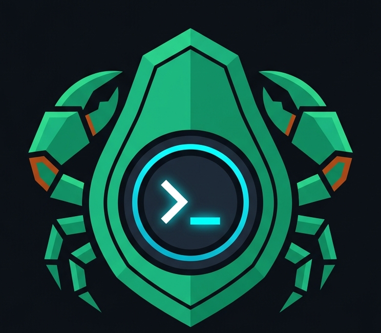
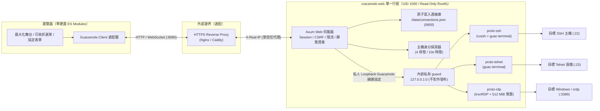

#  cracamole

> **無 Java、單一執行檔、內嵌私有協定引擎的瀏覽器遠端連線工作台（SSH / Telnet / RDP）**

`cracamole`（**Crab** 🦀 + **Guacamole** 🥑）是以純 Rust 重新設計與實作的無客戶端遠端存取系統，致敬開源遠端桌面先驅 **[Apache Guacamole™](https://guacamole.apache.org/)**。第一版聚焦於**單一管理員**的高效日常運維：提供管理員驗證、連線設定本機保存（新增／編輯／刪除），以及直接在瀏覽器中操作 **SSH、Telnet 與 RDP（Windows 遠端桌面）**。

整套系統延續了 Apache Guacamole 優雅的「串流指令協定（Guacamole Protocol）」與前端畫布渲染理念，同時**完全移除 Java、Tomcat、Maven、外部資料庫與前端打包工具鏈**：前端靜態資產（HTML / CSS / 原生 ES Modules）於編譯期直接封裝進 `cracamole-web` 單一執行檔，並在同行程內啟動僅綁定私人 loopback（`127.0.0.1:0`）的 Guacamole 協定 daemon。對外只暴露單一 HTTP / WebSocket 服務埠。

---

## 架構設計筆記（Architecture Overview）



### 1. 為什麼採用「單一執行檔＋內嵌私人 Loopback Daemon」？
傳統 Apache Guacamole 需要同時維運 Tomcat（Java WebApp）、`guacd`（C daemon，預設監聽 4822 埠）與外部關聯式資料庫，不僅映像體積龐大，且一旦 4822 埠誤對外暴露，任何能連上 `guacd` 的來源都可在未經 Web 驗證下發起遠端連線。

在 `cracamole` 中：
- **零外部協定埠暴露**：`cracamole-web` 啟動時向作業系統申請 `127.0.0.1:0` 隨機埠啟動內嵌 `guacd` 任務，不提供任何對外 TCP 監聽。所有 WebSocket tunnel 升級皆必須先通過 Web 層的 Cookie Session 與同源（Same-Origin）檢查，並由伺服器端直接從本機設定庫注入機密參數，瀏覽器永遠拿不到連線密碼或私鑰。
- **零執行期外部依賴**：前端採用原生 ES Modules 與 CSS Design Tokens（`web/`），由 `include_bytes!` 直接編入執行檔，並由單元測試（`every_web_file_is_served`）強制確保所有靜態檔皆有對應路由。正式環境不需要 Node.js（Node 僅用於開發期執行 Playwright E2E 與無障礙／對比度測試）。

### 2. Workspace 模組分層（10 Crates）
依賴方向嚴格由上往下，底層協定與顯示引擎絕不反向依賴 Web 層：

| Crate | 職責與架構邊界 |
|---|---|
| `cracamole-web` | **系統正式部署入口**。提供 Axum HTTP/WebSocket 服務、Argon2id 管理員驗證、連線 CRUD、SSH/RDP 主機身分探測、內嵌靜態資產與私人 loopback `guacd` 生命週期管理。 |
| `guacd` | Guacamole 線路協定路由與外掛註冊表（`Registry`）。可獨立執行以供相容性測試，但**非**完整 Web 系統入口。 |
| `proto-ssh` | 純 Rust SSH 客戶端（基於 `russh`），支援密碼、OpenSSH/PEM 私鑰與密語、嚴格 `known_hosts` 驗證（含 `@revoked` 撤銷檢查）、PTY 動態縮放、雙向剪貼簿與安全貼上過濾。 |
| `proto-telnet` | Telnet 狀態機與自動登入提示字元（正規表示式）比對，共用 `guac-terminal` 渲染管線。 |
| `proto-rdp` | 純 Rust RDP 引擎（基於 `IronRDP`），提供遠端桌面畫面、鍵盤、滑鼠、雙向文字剪貼簿、瀏覽器視窗動態縮放（Display Control DVC）與伺服器憑證 SHA-256 指紋釘選。 |
| `guac-terminal` | 終端機模擬器（整合 `alacritty_terminal` 與 `fontdue`），內建共享字型快取、單一 CJK fallback、髒矩形（dirty-region）合成、最小格點與字型配置上限防護。 |
| `guac-display` | 圖層與表面（Surface）髒矩形追蹤、PNG 編碼與畫格批次發送器。 |
| `guac-session` | 單一連線工作階段之讀寫迴圈、閒置心跳（`nop`/`sync`）與優雅關閉控制。 |
| `guac-protocol` | Guacamole 線路指令（`len.content,len.content;`）零配置／串流解析器與編碼器，具備嚴格元素長度上限。 |
| `guac-testkit` | 測試專用輔助庫（僅作為 `dev-dependency`）。 |

### 3. 介面與操作體驗設計（UI/UX Architecture）
針對系統管理員長時間操作 SSH 與 RDP 的核心痛點，前端（`web/`）遵循以下工程設計（規範詳見 [`web/GUIDELINES.md`](web/GUIDELINES.md)）：
- **最大化遠端畫面與可收折選單**：
  - 連線建立時自動收折左側連線庫，讓終端機／遠端桌面取得 **100% 視窗寬度**。
  - 連線途中若展開左側連線庫，抽屜會以**浮動覆蓋層（Overlay Drawer）**滑出，**絕不推擠舞台寬度或觸發遠端 PTY / RDP 重新縮放**。
  - 底部狀態列提供 **「最大畫面」**（收折頂欄與底欄，使遠端畫布佔滿 `100vw × 100dvh`）與 **「全螢幕」**（原生 Fullscreen API）模式。
- **常駐連線狀態（Persistent Status）**：
  - 頂欄連線膠囊、底部狀態列、連線庫中的活躍卡片，以及「最大畫面」模式右上角的輕量浮動膠囊，皆同步顯示即時連線燈號與狀態（`正在連線…`、`已連線`、`連線已結束`、`連線失敗`）。
  - 斷線或驗證失敗時，在舞台中央以半透明覆蓋層明確區分原因（找不到主機、連線逾時、驗證失敗、主機金鑰／憑證未信任或已變更），並就地提供「重新連線」或「編輯連線」。
- **過多設定的漸進式揭露（Progressive Disclosure）**：
  - 連線編輯器採用**固定標題與固定底部操作列**（`取消`、`儲存並連線`、`儲存連線` 永遠可見），基本欄位以雙欄緊湊排列。
  - 進階選項依協定（SSH / Telnet / RDP）動態切換並收折於 `<details>` 區塊中；每個折疊標題即時顯示 **「已設定 N 項 / 預設」摘要徽章**，並提供 **「全部收合」** 按鈕，避免設定過多時捲動迷航。
- **鍵盤優先與觸控輔助**：
  - 按 `/` 快速展開連線庫並聚焦搜尋框，按 `Enter` 直接連線第一筆符合的主機；在終端機內按 `Ctrl+Shift+Escape` 可脫離終端機焦點回到頂欄選單（避免鍵盤焦點陷阱）。
  - 行動端（390px）與觸控螢幕提供專屬輔助鍵列（`Esc`、`Tab`、單次黏滯 `Ctrl`/`Alt`、方向鍵與常用管線符號）。

---

## 安全邊界與資源防護（Security & Resource Guardrails）

1. **身分驗證與工作階段管理**
   - 管理員帳號與密碼由環境變數提供，**無預設密碼**，且啟動時強制檢查密碼長度至少 **12 個字元**（不超過 256 bytes）。
   - 密碼雜湊採用 **Argon2id**（驗證併發由 Semaphore 限制，防止 CPU 耗盡攻擊）；登入端點具備依來源 IP 的速率限制（每 60 秒最多 10 次嘗試，超限回傳 `429 Too Many Requests`）。
   - Session Cookie 預設啟用 `HttpOnly; SameSite=Strict; Path=/`（8 小時有效期，儲存於記憶體，服務重啟後須重新登入）；所有狀態變更 API 與 WebSocket 升級均強制檢查 `Origin` 與 `Host` 同源。
   - **登出、Session 到期或收到 `SIGTERM` / `SIGINT` 關機訊號時，會立即透過 `CancellationToken` 中止該工作階段下所有活躍的遠端 tunnel 與主機探測任務**。
2. **主機身分驗證（TOFU 與憑證釘選）**
   - **SSH 主機金鑰**：每次連線皆嚴格比對 `host-key`（OpenSSH `known_hosts` 格式）。尚未設定時，首次連線會先阻擋並透過探測 API 取得遠端公鑰與 **SHA-256 指紋**，由管理員核對後按「信任這把主機金鑰並重新連線」寫回設定；之後金鑰不符或命中 `@revoked` 撤銷標記時一律拒絕連線，不支援的標記或損毀紀錄亦拒絕載入，**絕不靜默降級為不驗證**。
   - **RDP 伺服器憑證**：預設嚴格驗證 TLS 憑證鏈；遇到自簽憑證時會先阻擋並顯示主體、簽發者與 **SHA-256 指紋**，核對後可一鍵釘選該指紋（`server-cert-sha256`）。
   - **探測任務防護**：主機身分探測（`/host-key` 與 `/certificate`）全系統共用最多 **4 個併發額度**，整段 DNS、TCP 與協定握手強制 **10 秒逾時**，且探測過程絕不傳送遠端登入帳密。
3. **記憶體、剪貼簿與貼上安全預算**
   - **RDP 記憶體預算**：遠端回報的桌面單邊像素不得超過 `4096px`；全程序共用 **512 MiB** 的 RDP 圖形記憶體額度（涵蓋解碼圖、輸出 framebuffer 與暫存緩衝區估算），超額時直接拒絕新配置。
   - **剪貼簿與安全貼上**：每個連線最多同時 4 條剪貼簿串流、總量上限 **256 KiB**，串流閒置 15 秒即中止（超限不貼上殘缺內容）。SSH / Telnet 貼上時會過濾 `ESC` 與危險控制字元（僅保留 Tab 與換行），防止惡意剪貼簿文字突破 Bracketed Paste 邊界直接執行指令。
4. **連線設定與機密保存現況（重要）**
   - 連線設定以原子替換（`NamedTempFile` + `sync_all` + `persist`）保存於 `/data/connections.json`，Unix 目錄權限為 `0700`、檔案權限為 `0600`。
   - **機密欄位（密碼、私鑰、密語）目前於磁碟上為明文保存，尚未實作靜態加密（Encryption at Rest）**。請務必保護宿主機的 Docker volume、備份檔案與 `.env`。
   - HTTP API 永遠只回傳 `configured_secrets: ["password", ...]` 清單，**絕不回傳密碼、私鑰或密語原文**；編輯連線時密碼留空會保留原值，勾選「清除已保存的密碼與私鑰」才會移除。

---

## 部署指南（Deployment Guide）

### 1. 快速啟動（Docker Compose，本機 Loopback）

在專案根目錄建立 `.env`（已被 `.gitignore` 忽略），設定至少 12 個字元的管理員密碼：

```dotenv
CRACAMOLE_ADMIN_USERNAME=admin
CRACAMOLE_ADMIN_PASSWORD=replace-with-your-own-strong-password
```

建置並啟動正式容器：

```sh
docker compose -f docker/compose.yml up -d --build --wait
```

- 開啟瀏覽器前往 <http://localhost:8080/> 並使用上述帳密登入。
- **預設安全綁定**：`docker/compose.yml` 預設只將連接埠發布至宿主機 loopback（`127.0.0.1:8080:8080`），且**不發布任何 `guacd` 連接埠**。
- **容器強化設定**：正式映像基於 `alpine:3`（含 `font-noto-cjk` 中文字型），以非特權使用者 `UID 1000`（`cracamole`）、**唯讀根檔案系統（`read_only: true`）**、移除全部 Linux capabilities（`cap_drop: [ALL]`）、`no-new-privileges:true`、記憶體上限 `1536m` 與 `pids_limit: 128` 執行。
- **資料持久化**：連線設定儲存在 Docker 具名 volume `connections`（掛載於 `/data`）。執行 `docker compose -f docker/compose.yml down -v` 會刪除該 volume。
- **注意容器網路解析**：連線設定中的目標主機名稱是由容器內部解析，因此在容器內填寫 `localhost` 指的是容器本身，而非宿主機。

### 2. 生產環境遠端部署（搭配 HTTPS Reverse Proxy）

`cracamole-web` 本身不直接終止 TLS。需要從外部網路存取時，請將容器維持綁定在 `127.0.0.1:8080`，並在前方部署支援 WebSocket 的 HTTPS 反向代理（如 Nginx 或 Caddy），同時啟用 `CRACAMOLE_SECURE_COOKIE` 與 `CRACAMOLE_TRUSTED_PROXIES`。

#### 步驟 A：更新 `.env`

```dotenv
CRACAMOLE_ADMIN_USERNAME=admin
CRACAMOLE_ADMIN_PASSWORD=replace-with-your-own-strong-password
CRACAMOLE_SECURE_COOKIE=true
# 填入 cracamole-web 實際看到的反向代理 TCP peer IP（逗號分隔）
# 若 Nginx 跑在宿主機且透過 127.0.0.1:8080 轉發至容器，容器看到的 peer IP 通常為 Docker bridge gateway（例如 172.18.0.1）；
# 若兩者皆在宿主機原生執行，則為 127.0.0.1,::1。
CRACAMOLE_TRUSTED_PROXIES=127.0.0.1,::1
```

> **關於 `CRACAMOLE_TRUSTED_PROXIES` 與登入限流**：
> - 應用程式**只信任**列在 `CRACAMOLE_TRUSTED_PROXIES` 中的 TCP peer IP 所傳來的單一 `X-Real-IP` 標頭；若受信任代理未帶、帶了多個或格式無效的 `X-Real-IP`，請求會被拒絕（`400 Bad Request`）。
> - 來自非受信任 peer 的轉送標頭會被完全忽略；系統**不使用**容易被偽造附加的 `X-Forwarded-For`。
> - 若經由反向代理卻未設定 `CRACAMOLE_TRUSTED_PROXIES`，所有外部使用者都會被視為同一個代理 IP 而共用每分鐘 10 次的登入限流額度。

#### 步驟 B：Nginx 反向代理設定範例

請確保反向代理**保留原始 `Host` 與 `Origin` 標頭**（通過同源檢查）、**支援 WebSocket 升級**，並**強制覆寫 `X-Real-IP` 為直連客戶端 IP**：

```nginx
server {
    listen 443 ssl http2;
    server_name term.example.com;

    ssl_certificate     /etc/letsencrypt/live/term.example.com/fullchain.pem;
    ssl_certificate_key /etc/letsencrypt/live/term.example.com/privkey.pem;

    location / {
        proxy_pass http://127.0.0.1:8080;
        proxy_http_version 1.1;

        # 保留 Host 與 Origin 以通過 cracamole-web 的同源檢查
        proxy_set_header Host $host;
        proxy_set_header Origin $http_origin;

        # 覆寫為真實客戶端單一 IP（供 CRACAMOLE_TRUSTED_PROXIES 限流識別）
        proxy_set_header X-Real-IP $remote_addr;

        # WebSocket Tunnel 升級標頭
        proxy_set_header Upgrade $http_upgrade;
        proxy_set_header Connection "upgrade";

        # 關閉代理緩衝以降低終端機與 RDP 畫面延遲
        proxy_buffering off;
        proxy_read_timeout 3600s;
        proxy_send_timeout 3600s;
    }
}
```

### 3. 環境變數一覽

| 環境變數 | 必填 | 預設值 | 說明 |
|---|---|---|---|
| `CRACAMOLE_ADMIN_PASSWORD` | **是** | 無 | 管理員登入密碼，**至少 12 個字元**、最長 256 bytes；未設定或過短時拒絕啟動。 |
| `CRACAMOLE_ADMIN_USERNAME` | 否 | `admin` | 管理員登入帳號（1–128 bytes）。 |
| `CRACAMOLE_HTTP_BIND` | 否 | `127.0.0.1:8080`（本機）<br>`0.0.0.0:8080`（容器內） | Web 伺服器綁定位址與連接埠。 |
| `CRACAMOLE_DATA_DIR` | 否 | `data`（本機）<br>`/data`（容器內） | 儲存 `connections.json` 的私有資料目錄（自動設為 `0700`）。 |
| `CRACAMOLE_SECURE_COOKIE` | 否 | `false` | 設為 `true` 時，Session Cookie 附加 `; Secure` 屬性（透過 HTTPS 存取時務必啟用）。 |
| `CRACAMOLE_TRUSTED_PROXIES` | 否 | 空字串 | 逗號分隔的受信任反向代理來源 IP 清單（僅信任這些 peer 覆寫的 `X-Real-IP`）。 |
| `CRACAMOLE_FONT_DIRS` | 否 | 系統字型路徑 | 額外搜尋 CJK 後備字型的目錄清單。 |
| `LOG_LEVEL` | 否 | `info` | 日誌層級（`error`、`warn`、`info`、`debug`、`trace`）。 |

### 4. 本機原生開發與啟動

不需要啟動 Docker，只需安裝 Rust 工具鏈即可在本機編譯與執行完整系統：

```powershell
# PowerShell
$env:CRACAMOLE_ADMIN_PASSWORD = 'replace-with-your-own-long-password'
cargo run --locked -p cracamole-web
```

```sh
# Bash / POSIX sh
CRACAMOLE_ADMIN_PASSWORD='replace-with-your-own-long-password' cargo run --locked -p cracamole-web
```

預設監聽 <http://127.0.0.1:8080/>，連線設定保存於本機 `./data/connections.json`（已被 Git 忽略）。

> **Windows 開發提示**：若遇到中斷建置留下的 MSVC 增量連結錯誤，可先設定 `$env:CARGO_INCREMENTAL='0'` 後再執行 `cargo`。

---

## 測試、驗證與品質門檻（Verification & Testing）

### 1. Rust 靜態檢查、單元測試與基準測試

```sh
cargo fmt --all -- --check
cargo clippy --workspace --all-targets --locked -- -D warnings
cargo test --workspace --locked
cargo test --workspace --locked --test stress -- --ignored --nocapture
cargo bench -p guac-terminal --bench mvp --locked
```

> 部分整合測試需要本機具備 `ssh-keygen`、`sh`、參考 C 原始碼或 CJK 字型；若執行環境缺少對應工具會自動跳過，檢視測試報告時請區分「實際通過數」與「因環境略過數」。

### 2. 前端快速檢查與本機 UI / 無障礙測試（無須 Docker）

```sh
# 88 組亮暗主題色彩對比度檢查、ES Module 語法檢查與斷線原因分類測試
node --test tests/e2e/contrast.test.js tests/e2e/syntax.test.js tests/e2e/reasons.test.js
```

若本機已編譯 `cracamole-web` 並安裝 Playwright，可直接針對本機執行檔跑跨瀏覽器（Chromium / Firefox / WebKit）介面與 `@axe-core/playwright` WCAG 2.2 AA 無障礙測試：

```sh
cd tests/e2e
npm ci
npx playwright install chromium firefox webkit
npx playwright test ui.spec.js -g "ui:|mobile: nothing scrolls"
```

### 3. 完整無 Java 瀏覽器 E2E 測試（含 SSH / Telnet / RDP 實機容器）

E2E 測試全程使用 Rust `cracamole-web` 搭配一次性的 `sshd`、`telnetd` 與 `xrdp` 測試容器，並以瀏覽器合成後的**實際畫面截圖像素（`visibleInk`）**斷言終端機與遠端桌面確實完成渲染（防止負 z-index canvas 被背景遮蔽卻空過）：

#### 本機具備 Docker 時：

```sh
docker compose -p cracamole-e2e -f docker/compose.e2e.yml up -d --build --wait
cd tests/e2e
npm ci
npx playwright install chromium
npm test
cd ../..
python scripts/validate_web_container.py
docker compose -p cracamole-e2e -f docker/compose.e2e.yml down -v
```

#### 使用遠端 Docker 主機時（一鍵同步、轉發、三瀏覽器測試與自動清理）：

```sh
# 完整 E2E 套件（於遠端獨立目錄與獨立 compose 專案啟動，結束自動清理，不影響遠端既有服務）
scripts/e2e_remote.sh user@docker-host

# RDP 快速開發迴圈（僅在遠端啟動 xrdp 容器，直接連本機編譯的 cracamole-web，省去映像建置時間）
scripts/rdp_dev.sh user@docker-host
```

### 4. 相容性與模糊測試（Compatibility & Fuzzing）

- **Apache Guacamole JS 客戶端**：位於 `web/vendor/`（唯讀，保留完整 Apache-2.0 `LICENSE` 與 `NOTICE`），可由 `python scripts/vendor_guacamole.py` 依釘選版本與 checksum 重建。
- **C 版 `guacd` 參數差分測試（Oracle）**：僅用於驗證協定外掛參數相容性（預設釘選上游 commit `bb1ba8ed1414ec6a239cea265d4e9c7e23b9c6a3`），不屬於正式執行環境：
  ```sh
  python -m unittest discover -s tests/oracle -v
  docker compose -p cracamole-oracle -f docker/compose.oracle.yml up -d --build --wait
  python tests/oracle/compare_args.py
  docker compose -p cracamole-oracle -f docker/compose.oracle.yml down -v
  ```
- **Fuzzing**：獨立工作區位於 [`fuzz/`](fuzz/README.md)，針對協定解析器、終端機 ANSI 序列與 RDP 訊息進行模糊測試。

---

## 現行產品範圍與未來路線（Scope & Roadmap）

| 類別 | 已實作並納入驗收 | 尚未納入（延後或規劃中） |
|---|---|---|
| **支援協定** | **SSH**（密碼／私鑰／known_hosts 指紋核對與撤銷檢查）<br>**Telnet**（密碼／登入成功與失敗正規表示式）<br>**RDP**（IronRDP：NLA/TLS、憑證 SHA-256 指紋核對、鍵鼠、雙向文字剪貼簿、動態解析度縮放） | VNC、Kubernetes、Serial、SFTP 檔案傳輸、RDP 音訊／磁碟機重新導向／RemoteApp |
| **管理與驗證** | 單一管理員（環境變數帳密、Argon2id、登入限流、同源檢查、受信任代理 `X-Real-IP`） | 多使用者帳號、RBAC 角色權限、OIDC / LDAP 整合、連線設定靜態加密（Encryption at Rest） |
| **操作介面** | 亮暗主題、最大化遠端畫面（收折頂底選單／全螢幕）、覆蓋式連線庫抽屜、進階設定折疊摘要、常駐連線狀態、手機觸控輔助鍵列 | 多分頁同時維持多條工作階段、工作階段錄影回放、共享連線（Screen Sharing） |

---

## 致敬 Apache Guacamole™ 與版權聲明（Tribute, Licensing & Copyright Notice）

`cracamole` 的誕生深受 **[Apache Guacamole™](https://guacamole.apache.org/)** 啟發，特此向 Apache Guacamole 專案及其社群致上最高敬意：

- **開創性的無客戶端協定設計**：Apache Guacamole 定義的文字化串流指令協定（`guac-protocol`）將圖層合成、髒矩形更新、鍵盤 X11 keysym 與雙向剪貼簿串流抽象得極為精煉，使瀏覽器不需安裝任何外掛即可獲得流暢的遠端終端機與桌面體驗。
- **前端核心與線路相容性**：本專案於 `web/vendor/` 直接沿用上游經過千錘百鍊的 `guacamole-common-js` 客戶端程式庫（依 Apache License 2.0 完整保留 [`LICENSE`](web/vendor/LICENSE) 與 [`NOTICE`](web/vendor/NOTICE)），並在伺服器端以純 Rust 打造相容的線路協定與現代化的單一執行檔架構。
- **站在巨人的肩膀上**：`cracamole` 並非為了取代大型企業級多租戶部署的 Apache Guacamole，而是將其卓越的協定思想帶入「零 Java、零外部資料庫、低資源占用、單一 Rust 執行檔」的輕量化運維場景。

### 版權、授權與聯絡方式

- 本專案之 Rust 伺服器與前端程式碼採用 [Apache License 2.0](LICENSE) 釋出；內附之第三方組件（`web/vendor/` 下之 `guacamole-common-js` 及 `crates/guac-terminal/assets/fonts/` 下之 DejaVu 字型）皆依其原始授權條款保留完整之版權聲明與授權文件。
- Apache Guacamole、Guacamole 與 Apache 標誌為 Apache Software Foundation（ASF）之註冊商標或商標，本專案與 Apache Software Foundation 無隸屬或官方背書關係。
- 本專案始終尊重開源社群與智慧財產權。若您發現本儲存庫中有任何程式碼、字型、文件、商標標示或授權聲明存在版權疑慮或未盡完善之處，**請隨時透過 GitHub Issues 或直接與專案作者聯繫**，我們會在收到通知後第一時間核實並配合修正或移除相關內容。
