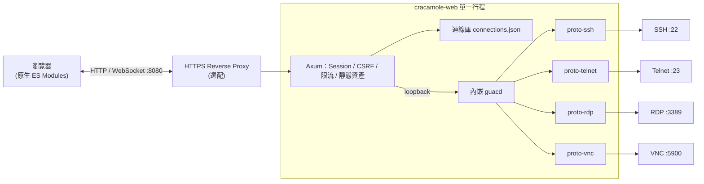

#  cracamole

> **無 Java、單一執行檔的瀏覽器遠端連線工作台（SSH / Telnet / RDP / VNC）**

`cracamole`（**Crab** 🦀 + **Guacamole** 🥑）是以純 Rust 重新實作的無客戶端遠端存取系統，致敬 **[Apache Guacamole™](https://guacamole.apache.org/)**。目前聚焦**單一管理員**的日常運維：登入驗證、連線設定本機保存（新增／編輯／刪除），並直接在瀏覽器操作 SSH、Telnet、RDP 與 VNC（含 macOS 螢幕共享）。

沿用 Guacamole 串流指令協定與前端畫布渲染，但**移除 Java、Tomcat、外部資料庫與前端打包工具鏈**：前端靜態資產（HTML / CSS / 原生 ES Modules）編譯期內嵌進 `cracamole-web`，同行程內啟動僅綁定 `127.0.0.1:0` 的私有 guacd；對外只開一個 HTTP / WebSocket 埠。

## 架構



- **零外部協定埠暴露**：WebSocket tunnel 必須先通過 Cookie Session 與同源檢查，機密參數由伺服器端注入，瀏覽器拿不到密碼或私鑰。
- **零執行期外部依賴**：靜態資產以 `include_bytes!` 編入，使用內容雜湊版本路徑與長期快取；Node.js 僅用於開發期 E2E 測試。

### Crates

| Crate | 職責 |
|---|---|
| `cracamole-web` | 正式部署入口：Axum 服務、Argon2id 驗證、連線 CRUD、主機身分探測、內嵌資產、私有 guacd 生命週期 |
| `cracamole-store` | 管理員驗證、連線設定驗證與保存（Web 與桌面版共用） |
| `cracamole-desktop` | Windows 原生版（Win32 備援）與 GPUI 啟動器 |
| `guacd` | 線路協定路由與外掛註冊表 |
| `proto-ssh` | SSH（`russh`）：密碼／私鑰、嚴格 `known_hosts`、PTY 縮放、剪貼簿 |
| `proto-telnet` | Telnet 狀態機與自動登入 |
| `proto-rdp` | RDP（`IronRDP`）：NLA/TLS、憑證指紋釘選、動態縮放、文字剪貼簿 |
| `proto-vnc` | VNC（RFB 3.3/3.7/3.8），優先支援 macOS ARD 驗證 |
| `guac-terminal` / `guac-display` / `guac-session` / `guac-protocol` | 終端機模擬、顯示圖層、工作階段迴圈、協定編解碼 |
| `guac-testkit` | 測試輔助（僅 dev-dependency） |

## 快速開始

### Docker Compose

在專案根目錄建立 `.env`（已被 Git 忽略）：

```dotenv
CRACAMOLE_ADMIN_USERNAME=admin
CRACAMOLE_ADMIN_PASSWORD=replace-with-your-own-strong-password
```

```sh
docker compose -f docker/compose.yml up -d --build --wait
```

開啟 <http://localhost:8080/> 登入。預設只發布至宿主機 `127.0.0.1:8080`，容器以非特權使用者、唯讀根檔案系統、`cap_drop: [ALL]` 執行；連線設定存於 volume `connections`（`down -v` 會刪除）。目標主機名稱由容器內解析，`localhost` 指容器本身。

### 本機執行

```powershell
$env:CRACAMOLE_ADMIN_PASSWORD = 'replace-with-your-own-long-password'
cargo run --locked -p cracamole-web
```

預設監聽 <http://127.0.0.1:8080/>，資料存於 `./data/connections.json`。Windows 若遇增量連結錯誤，先設 `$env:CARGO_INCREMENTAL='0'`。

### 對外部署（HTTPS 反向代理）

`cracamole-web` 不終止 TLS。請維持綁定 `127.0.0.1:8080`，前方放支援 WebSocket 的 Nginx／Caddy，並在 `.env` 加入：

```dotenv
CRACAMOLE_SECURE_COOKIE=true
# cracamole-web 實際看到的代理 peer IP（宿主機 Nginx → 容器時通常是 Docker bridge gateway，如 172.18.0.1）
CRACAMOLE_TRUSTED_PROXIES=127.0.0.1,::1
```

代理須：保留 `Host` 與 `Origin`、支援 WebSocket 升級、將 `X-Real-IP` 覆寫為直連客戶端 IP。未設定 `CRACAMOLE_TRUSTED_PROXIES` 時，所有使用者會共用同一個登入限流額度。

```nginx
location / {
    proxy_pass http://127.0.0.1:8080;
    proxy_http_version 1.1;
    proxy_set_header Host $host;
    proxy_set_header Origin $http_origin;
    proxy_set_header X-Real-IP $remote_addr;
    proxy_set_header Upgrade $http_upgrade;
    proxy_set_header Connection "upgrade";
    proxy_buffering off;
    proxy_read_timeout 3600s;
    proxy_send_timeout 3600s;
}
```

### 環境變數

| 變數 | 必填 | 預設 | 說明 |
|---|---|---|---|
| `CRACAMOLE_ADMIN_PASSWORD` | **是** | — | 管理員密碼，12–256 bytes |
| `CRACAMOLE_ADMIN_USERNAME` | 否 | `admin` | 管理員帳號（1–128 bytes） |
| `CRACAMOLE_HTTP_BIND` | 否 | `127.0.0.1:8080`（容器內 `0.0.0.0:8080`） | 綁定位址 |
| `CRACAMOLE_DATA_DIR` | 否 | `data`（容器內 `/data`） | 資料目錄（自動設為 `0700`） |
| `CRACAMOLE_SECURE_COOKIE` | 否 | `false` | Cookie 加 `Secure`（HTTPS 時啟用） |
| `CRACAMOLE_TRUSTED_PROXIES` | 否 | 空 | 受信任代理 IP（逗號分隔） |
| `CRACAMOLE_FONT_DIRS` | 否 | 系統字型路徑 | 額外 CJK 後備字型目錄 |
| `LOG_LEVEL` | 否 | `info` | `error`／`warn`／`info`／`debug`／`trace` |

## Windows 桌面版

`desktop-gpui/` 是以 GPUI 實作的 Windows 原生介面（預設），含群組、搜尋與快速連線、匯入／匯出、SSH／RDP 信任管理與四協定工作階段。它是獨立的 Cargo workspace，重用 `cracamole-store` 與 `cracamole-desktop` 的連線庫與驅動。Win32 版（`cracamole-desktop-win32`）保留為備援。

```powershell
.\scripts\run_desktop.ps1            # 預設 GPUI 版（隱藏輸入密碼）
.\scripts\run_desktop.ps1 -Release
.\scripts\run_desktop.ps1 -Legacy    # Win32 備援版
```

- 環境變數：`CRACAMOLE_ADMIN_USERNAME`／`CRACAMOLE_ADMIN_PASSWORD`（≥12 字元）、`CRACAMOLE_DESKTOP_DATA_DIR`、`CRACAMOLE_DESKTOP_SESSION_MAX_SECS`（1–28800，預設 8 小時，無效值會報錯退出）。
- 桌面資料存於 `%LOCALAPPDATA%\cracamole-desktop`，**不可與 Web 的 `CRACAMOLE_DATA_DIR` 設為同一目錄**，也不會自動遷移 Web 連線。
- 測試：`cd desktop-gpui; cargo test`（設 `RUST_MIN_STACK=536870912`）。
- **驗收狀態**：自動化測試涵蓋本機 Telnet／SSH／RDP fixture 與最小 RFB 伺服器；實機可見畫面、實體輸入、輸入法、高 DPI 與真實 Windows／xrdp 服務**尚待驗收**。
- 設計準則詳見 [`web/GUIDELINES.md`](web/GUIDELINES.md) §5.1、§11、§12。

## 安全邊界

1. **驗證與 Session**：密碼由環境變數提供、無預設值、至少 12 字元；Argon2id 雜湊（併發受限）；登入依 IP 限流（60 秒 10 次，超限 `429`）；Cookie 為 `HttpOnly; SameSite=Strict`、8 小時、存於記憶體；狀態變更 API 與 WebSocket 升級強制同源檢查；登出、到期或收到 `SIGTERM`／`SIGINT` 時立即中止該 Session 的所有 tunnel 與探測。
2. **主機身分**：SSH 嚴格比對 `known_hosts`（含 `@revoked`），首次連線先阻擋並顯示 SHA-256 指紋供核對，**絕不靜默降級為不驗證**；RDP 預設驗證憑證鏈，自簽憑證可核對後釘選指紋。探測全系統最多 4 併發、10 秒逾時，且不傳送登入帳密。
3. **資源預算**：RDP 與 VNC 桌面單邊上限 4096px，全程序圖形記憶體分別為 512 MiB／256 MiB；VNC 有解壓縮上限，且設了帳密卻只提供「無驗證」時拒絕連線。剪貼簿每連線最多 4 條串流、256 KiB；SSH／Telnet 貼上會過濾 `ESC` 與危險控制字元。
4. **機密保存（重要）**：連線設定以原子替換寫入 `/data/connections.json`（目錄 `0700`、檔案 `0600`）。**密碼、私鑰、密語目前以明文保存，尚未實作靜態加密**，請保護 Docker volume、備份與 `.env`。HTTP API 只回傳 `configured_secrets` 清單，不回傳機密原文。
5. **VNC／ARD 只加密登入憑證，畫面與輸入不加密**，請在受信任網路、VPN 或 SSH 通道內使用。

## 測試與驗證

```sh
# Rust
cargo fmt --all -- --check
cargo clippy --workspace --all-targets --locked -- -D warnings
cargo test --workspace --locked

# 前端（對比度、語法、斷線原因分類，無須 Docker）
node --test tests/e2e/contrast.test.js tests/e2e/syntax.test.js tests/e2e/reasons.test.js

# 完整瀏覽器 E2E（SSH / Telnet / RDP 測試容器 + Playwright）
docker compose -p cracamole-e2e -f docker/compose.e2e.yml up -d --build --wait
cd tests/e2e && npm ci && npx playwright install chromium && npm test
docker compose -p cracamole-e2e -f docker/compose.e2e.yml down -v
```

- 使用遠端 Docker 主機：`scripts/e2e_remote.sh user@docker-host`；RDP 快速迴圈 `scripts/rdp_dev.sh`；VNC 互通 `scripts/vnc_dev.sh`；文字編碼 `scripts/text_dev.sh`。
- 部分整合測試需要 `ssh-keygen`、`sh` 或 CJK 字型，缺少時會自動跳過；檢視結果請區分「通過」與「略過」。
- 相容性：`web/vendor/` 為唯讀的上游 `guacamole-common-js`（`python scripts/vendor_guacamole.py` 重建）；C 版 guacd 參數差分測試見 `tests/oracle/`；模糊測試見 [`fuzz/`](fuzz/README.md)。
- **VNC**：ARD 驗證以獨立實作向量與模擬伺服器交叉核對，**尚未在真實 macOS 驗證**；VNC 密碼、ZRLE 與縮放已對真實 TigerVNC 驗證。連 Mac 需開啟「系統設定 > 一般 > 共享 > 螢幕共享」，中文剪貼簿請將「剪貼簿文字編碼」設為 UTF-8。
- **文字編碼**：SSH／Telnet 預設 UTF-8，舊系統可手動選 Big5、GBK、Shift_JIS 等，不自動猜測；RDP 使用 Unicode，不受此設定影響。複雜文字塑形、雙向文字與實機 IME 尚未完整驗收。

## 範圍與路線

| 類別 | 已實作 | 尚未納入 |
|---|---|---|
| 協定 | SSH、Telnet、RDP（NLA/TLS、動態縮放）、VNC（ARD、ZRLE/Hextile/CopyRect/Raw） | VNC Tight／遠端游標、Kubernetes、Serial、SFTP、RDP 音訊／磁碟機／RemoteApp |
| 管理 | 單一管理員、限流、同源檢查、受信任代理 | 多使用者、RBAC、OIDC／LDAP、靜態加密 |
| 介面 | 亮暗主題、最大化畫面、覆蓋式連線庫、群組與常駐狀態、行動端輔助鍵 | 多分頁工作階段、錄影回放、共享連線 |

## 致敬與授權

`cracamole` 深受 **Apache Guacamole™** 啟發，並於 `web/vendor/` 沿用其 `guacamole-common-js`（Apache-2.0，保留 [`LICENSE`](web/vendor/LICENSE) 與 [`NOTICE`](web/vendor/NOTICE)）。本專案並非要取代大型多租戶部署，而是提供零 Java、零外部資料庫的輕量單一執行檔方案。

- 本專案程式碼採用 [Apache License 2.0](LICENSE)；第三方組件（`guacamole-common-js`、`crates/guac-terminal/assets/fonts/` 的 DejaVu 字型）依其原授權保留。
- Apache Guacamole 與 Apache 標誌為 Apache Software Foundation 的商標，本專案與其無隸屬或官方背書關係。
- 如發現版權或授權疑慮，請透過 GitHub Issues 聯繫，將盡快核實處理。
