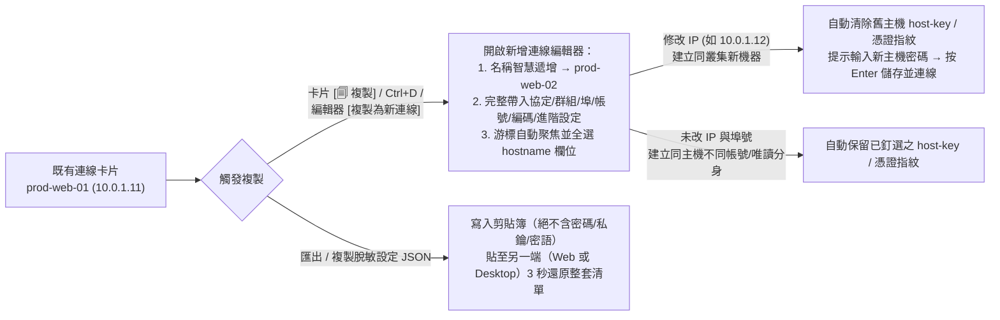

# `cracamole` 現代化 UI/UX 設計系統與產品體驗規格書（`design.md`）

> **文件定位**：本文件為 `cracamole`（Web 瀏覽器端 `web/` 與 Windows 原生桌面版 `crates/cracamole-desktop`）的專屬 UI/UX 設計規範。融合業界標竿遠端存取與運維工作台（**Termius、Nexterm、Royal TS、Devolutions Remote Desktop Manager (RDM)、Warp**）的現代化設計典範，以**「使用者操作便利性絕對優先（Convenience-First, Zero-Friction）」**為核心指導原則，並嚴格遵守 [`web/GUIDELINES.md`](web/GUIDELINES.md) 與 [`AGENTS.md`](AGENTS.md) 的安全與工程邊界。

---

## 1. 標竿產品研究與設計取經（Industry Benchmark Analysis）

為解決傳統開源遠端工具（如舊版 Apache Guacamole、傳統 PuTTY / Win32 工具）「設定繁瑣、卡片肥大、狀態不明、切換緩慢」的痛點，本設計吸收以下四款標竿產品的核心優勢：

| 標竿專案 | 核心 UI/UX 亮點 | `cracamole` 吸收並轉化之設計規格 |
|---|---|---|
| **[Termius](https://termius.com/)** | 1. **Quick Connect 極速直連列**（輸入 `user@host:22` 立即連線）<br>2. **Vault / Hosts 樹狀群組與標籤膠囊**<br>3. **收納複雜安全設定**（Known Hosts / Keys 移出主視野，按需揭露）<br>4. **Command Palette (`Ctrl+K`)** 全鍵盤流 | - 搜尋框升級為 **Omnibar（萬用搜尋＋即輸即連列）**<br>- **三層式高密度導覽樹**（★ 釘選 ＋ 可折疊群組 ＋ 單行緊湊卡片）<br>- 編輯器提供**就地主動指紋預檢**與 `<details>` 進階設定計數摘要 |
| **[Nexterm](https://nexterm.dev/)** | 1. **現代 SaaS 級別的深／淺色視覺階層**<br>2. **巢狀資料夾（Folders）與協定視覺化分類**<br>3. **單一視窗整合 SSH / RDP / VNC / Telnet** | - **語意化協定色彩標記**（SSH 翠綠、RDP 湛藍、VNC 琥珀、Telnet 岩灰）<br>- **視覺化協定分段切換器（Segmented Control）**取代傳統下拉選單<br>- 底部控制塢內建**最近工作階段快切膠囊（Recent Session Switcher）** |
| **[Royal TS](https://www.royalapps.com/) & [Devolutions RDM](https://devolutions.net/remote-desktop-manager/)** | 1. **高密度左側 Navigation Tree 與頂部 Filter Pane**（輸入關鍵字自動展開命中資料夾）<br>2. **快速篩選視圖**（Favorites 常用、Opened 已開啟、Recent 最近）<br>3. **一鍵複製項目（Clone / Duplicate）與右鍵快顯動作**<br>4. **左側樹狀導覽＋右側 100% 畫布的雙欄工作台** | - 單張卡片高度壓縮至 **`44px–50px`**（單屏可瀏覽 15–20 台主機）<br>- **完整連線設定複製（Clone）機制**（智慧序號遞增 `01→02`、游標直達 IP）<br>- **每張卡片常駐連線與指紋狀態**（斷線返回後保留最後錯誤／結束摘要）<br>- Windows 桌面版升級為**商業級雙欄分割工作台（Split-Pane Workbench）** |
| **[Apache Guacamole™](https://guacamole.apache.org/)** | 1. **零外掛瀏覽器畫布渲染與輕量串流協定**<br>2. **伺服器端集中管理機密，前端不落地** | - 保留 `guacamole-common-js` 畫布渲染與內嵌 loopback daemon 架構<br>- 廢除多頁跳轉後台，改為**零頂欄全視窗舞台＋浮動覆蓋式抽屜** |

---

## 2. 核心設計哲學與北極星指標（Core UX Philosophy & Metrics）

1. **極速首指令時間（TTFC, Time-to-First-Command ≤ 3 秒）**：
   - **日常連線 ≤ 2 次按鍵**：按 `/`（或啟動桌面版）→ 按 `Enter` 直接連上最常用或上次連線的主機。
   - **新增同叢集主機 ≤ 3 秒**：點擊卡片 `[🗐 複製]`（名稱自動由 `01` 遞增為 `02`，游標自動全選 IP）→ `Ctrl+V` 貼上新 IP → 輸入密碼按 `Enter`「儲存並連線」。
2. **高密度一屏視野（High-Density Scannability）**：
   - 拒絕部落格文章式肥大卡片。左側連線庫單屏（1080p 視窗）須能同時呈現 **15–20 台主機** 與 **3–5 個群組標頭**。
3. **全時狀態透明（100% Persistent Status Visibility）**：
   - 任何時刻打開連線庫，**每一張主機卡片**都必須明確顯示當前狀態（🟢 `已連線`、🟡 `正在連線…`、🔴 `驗證失敗／逾時／待核對`、⚪ `未連線`）與安全信任徽章（`🔒 已信任`）。連線失敗退回清單時，**嚴禁清空卡片上的失敗狀態**。
4. **工作階段零干擾與防誤觸（Session Safety & Zero Unexpected Resize）**：
   - 連線中展開左側連線庫或剪貼簿面板，一律採**浮動覆蓋層（Overlay）**，絕不推擠遠端畫布或觸發遠端 PTY / RDP 重新縮放。
   - 已連線（`connected`）狀態下點擊其他主機、按上一頁或重整頁面，**必須先彈出確認**；「登出」與「刪除」等破壞性按鈕必須與高頻操作保持物理距離。
5. **零外部依賴與無障礙合規（Zero Build & WCAG 2.2 AA）**：
   - Web 端維持純原生 ES Modules + CSS Design Tokens（[`web/css/tokens.css`](web/css/tokens.css)），無小於 `14px`（`0.875rem`）之 UI 文字，88 組亮暗色對比度 100% 通過腳本驗證。

---

## 3. 視覺設計系統與語意化 Tokens（Visual Design System）

### 3.1 表面層級與空間結構（Surface Hierarchy）
| 層級 Token | 暗色主題（預設） | 淺色主題 | 視覺用途 |
|---|---|---|---|
| `--terminal-bg` | `#000000` | `#000000` | 遠端終端機與桌面畫布底色（恆黑以確保 ANSI 色彩對比） |
| `--surface-sunken` | `#0a0f0c` | `#e9eee7` | 搜尋框底色、群組折疊凹槽、日誌檢視器背景、卡片 Hover 底色 |
| `--surface` | `#0f1512` | `#f5f7f2` | 連線庫卡片預設底色、控制塢膠囊底色 |
| `--surface-raised` | `#17201b` | `#ffffff` | 左側連線庫抽屜、底部狀態控制塢、`<dialog>` 對話框、浮動狀態面板 |
| `--overlay-scrim` | `rgb(5 10 7 / 72%)` | `rgb(20 30 24 / 55%)` | 模態對話框與斷線覆蓋層背景遮罩 |

### 3.2 語意化協定識別與連線狀態系統（Protocol & Status Semantics）
為讓管理員在毫秒內掃描辨識不同協定與連線健康度，定義以下視覺語意：

1. **協定小徽章（Protocol Badges，搭配文字標示，不單靠顏色）**：
   - **`SSH`**：終端機翠綠邊框／微底色（象徵 CLI 加密通道）
   - **`RDP`**：桌面湛藍邊框／微底色（象徵 Windows 圖形遠端桌面）
   - **`VNC`**：螢幕共享琥珀邊框／微底色（象徵 macOS ARD / 跨平台畫面共享）
   - **`Telnet`**：傳統設備岩灰邊框／微底色（搭配未加密提醒）
2. **每張卡片常駐的四態燈號（`.dot[data-state]` ＋ 狀態文字）**：
   - `data-state="connected"`（🟢 `--text-success`）：**`已連線`**（當前活躍工作階段，卡片外框高亮 `--accent`）
   - `data-state="connecting"`（🟡 `--text-warning` 脈動）：**`正在連線…`**
   - `data-state="error"`（🔴 `--text-danger`）：**`驗證失敗` / `遠端無回應` / `待核對指紋` / `連線失敗`**（保留該主機最近一次失敗原因，點擊卡片可直接重試或點 `✎` 修正）
   - `data-state="closed"` / `data-state="idle"`（⚪ `--border-strong`）：**`連線已結束`**（曾連線並正常退出）或 **`未連線`**（尚未發起連線）
3. **安全與權限微標記（Trust & Policy Micro-Badges）**：
   - `🔒 已信任`：已設定 SSH `host-key` 或 RDP `server-cert-sha256`。
   - `唯讀`：已啟用 `read-only: true` 禁止遠端鍵鼠輸入。

---

## 4. Web 端（`web/`）現代化介面架構與互動規格

### 4.1 整體空間佈局（Zero-Topbar Full-Viewport Workspace）

```mermaid
flowchart TB
  subgraph Viewport["瀏覽器視窗 (100vw × 100dvh，無頂部 Title Bar，舞台自 y=0 開始)"]
    direction TB
    subgraph MainArea["主工作區 (.shell, flex: 1)"]
      direction LR
      Drawer["左側：連線庫抽屜 (.drawer, 寬 22rem)\n- 未連線時停駐展開\n- 連線中自動收合；展開時為 data-overlay='true' 浮動層（絕不擠壓舞台）"]
      Stage["中央：100% 遠端舞台 (.stage)\n- #chrome-pill：最大畫面模式右上角浮動狀態膠囊\n- #terminal：遠端畫布 + 隱藏 <textarea id='terminal-ime'> 軟鍵盤代理\n- #overlay：連線中 / 斷線診斷 / TOFU 指紋核對半透明覆蓋卡\n- #clipboard-panel：浮動剪貼簿面板（貼後自動收合）\n- #keybar：行動端觸控輔助鍵列"]
      Drawer -. "浮動覆蓋 (不觸發 resize)" .-> Stage
    end
    Dock["底部：單一整合控制塢 (.statusbar, 高 2.25rem)\n[☰ 連線庫] [🟢 狀態燈號] [當前主機膠囊] [⚡ 最近連線快切膠囊 x2] ──spacer── [📋 一鍵貼上/剪貼簿] [⌨ 輔助鍵] [Ctrl+Alt+Del] [⛶ 最大畫面] [全螢幕] [系統日誌] [中斷連線] [主題] [登出]"]
    MainArea --> Dock
  end
```



### 4.2 左側連線庫：Omnibar ＋ 置頂釘選 ★ ＋ 可折疊群組 ＋ 46px 緊湊卡片

參考 **Termius** 與 **Royal TS / RDM** 的高密度導覽樹設計，將連線庫重構為四個垂直分區：

```
┌──────────────────────────────────────────────────────────┐
│ [🦀] 連線庫                           [＋新增連線] [收合] │
├──────────────────────────────────────────────────────────┤
│ 🔍 搜尋名稱、群組、IP 或輸入 user@host:port 直連 (/)     │
│ [⚡ 快速連線至 root@10.0.1.50:22 (按 Enter 立即建立)]    │ <-- 當輸入含 @ 或 :port 時動態浮現
├──────────────────────────────────────────────────────────┤
│ [全部] [★ 釘選] [SSH] [RDP] [VNC] [Telnet]   [↕ 全部折疊]│
├──────────────────────────────────────────────────────────┤
│ ★ 常用釘選 (2)                                           │
│ ┌──────────────────────────────────────────────────────┐ │
│ │ 🟢 [SSH] prod-bastion   root@10.0.0.1:22 🔒  [已連線]│ │
│ │ ⚪ [RDP] win-jumpbox   admin@10.0.0.2:3389 🔒[未連線]│ │
│ └──────────────────────────────────────────────────────┘ │
│ ▾ 正式環境 Production (1/3 已連線)                  [＋] │
│ ┌──────────────────────────────────────────────────────┐ │
│ │ 🟢 [SSH] prod-web-01    root@10.0.1.11:22 🔒 [已連線]│ │
│ │ 🔴 [RDP] prod-sql-01      sa@10.0.1.18:3389[驗證失敗]│ │
│ │ ⚪ [SSH] prod-web-02    root@10.0.1.12:22  [★ ✎ 🗐 🗑]│ │ <-- Hover/Focus 時浮現快顯動作列
│ └──────────────────────────────────────────────────────┘ │
│ ▸ 測試與 macOS 設備 (4 台)                          [＋] │
└──────────────────────────────────────────────────────────┘
```

1. **Omnibar 萬用搜尋與即輸即連（Quick Connect）**：
   - 按 `/`（或 `Ctrl+K`）立即展開抽屜並聚焦搜尋框。
   - **即時過濾與自動展開**：輸入關鍵字時，自動展開含有符合項目的 `<details class="conn-group">`，並隱藏無符合項目的群組。
   - **即輸即連（Ad-hoc Quick Connect）**：當輸入字串符合 `[protocol://][user@]host[:port]` 格式且按 `Enter` 時，若無完全匹配的既有卡片，直接開啟預填好協定、帳號、主機、埠號與預設名稱的編輯器（或一鍵建立並發起連線）。
   - **方向鍵直達**：在搜尋框或卡片清單中按 `ArrowDown` / `ArrowUp`，焦點直接在可見卡片的主連線按鈕（`.card__open`）間上下移動，按 `Enter` 立即連線、按 `Ctrl+D` 立即複製該連線。
2. **可折疊群組手風琴（Collapsible Groups）**：
   - **群組定義與 100% 向下相容**：
     - 支援在編輯器設定「群組（Group）」名稱（如 `正式環境 Production`）；若連線名稱寫為 `正式環境 / prod-web-01`，前端自動拆解 `/` 前綴作為群組名稱並顯示簡短主機名 `prod-web-01`（亦可透過 `cracamole-store` 的選填 `group` 欄位保存）。未指定群組者歸入「預設群組（未分類）」。
   - **群組標頭資訊**：顯示 `[▾ 旋轉箭頭] 群組名稱` ＋ 右側 `[活躍數/總數 徽章]` ＋ `[＋ 在此群組新增]` 按鈕。
   - **狀態記憶**：每個群組的展開／折疊狀態與「★ 釘選清單」保存於 `localStorage`（不含任何敏感資訊）。
3. **46px 高密度現代卡片與常駐狀態（Compact Card & Persistent Status）**：
   - **高度壓縮**：移除原本獨立佔據第 3 行的常駐編輯／刪除按鈕列。卡片改為單行／緊湊雙行結構（高 `44px–50px`）：
     - 左側：`[狀態燈號 .dot]` ＋ `[協定小徽章]` ＋ **`主機簡稱`** ＋ `user@host:port`（`--font-mono`）＋ `🔒`（已釘選身分）。
     - 右側：平時常駐顯示 **`[狀態文字徽章]`**（如 `已連線`、`驗證失敗`、`未連線`）；當滑鼠 `:hover` 或鍵盤 `:focus-within` 時，平滑顯示 **`[★ 釘選]`、`[✎ 編輯]`、`[🗐 複製]`、`[🗑 刪除]`** 四個緊湊圖示／文字按鈕。

---

### 4.3 連線設定複製與跨端配置遷移（Connection Cloning & Config Portability）

參考 **Devolutions RDM** 與 **Royal TS** 的 Duplicate / Template 機制，解決運維人員管理同叢集多主機及 Web ⇄ Windows 桌面版獨立資料目錄同步的痛點：



1. **一鍵複製為新連線（Quick Clone）**：
   - **三種觸發方式**：(1) 卡片右側快顯列的 `[🗐 複製]` 按鈕、(2) 編輯既有連線對話框底部的 `[複製為新連線]` 按鈕、(3) 聚焦於卡片時按 `Ctrl+D`。
   - **智慧名稱序號遞增（Smart Auto-Increment）**：
     - 若原名稱結尾含數字（如 `prod-web-01`、`db-node-9`），自動保持補零位數遞增為 **`prod-web-02`**、**`db-node-10`**；若無數字結尾則預填 `原名稱 - 複製`。
   - **游標直達修改點（Auto-Focus & Select `hostname`）**：
     - 打開複製後的編輯器時，因為名稱、群組、協定、連接埠、帳號與進階設定都已填妥，焦點**自動落在「主機名稱或 IP（`hostname`）」欄位並全選文字**。使用者只需直接 `Ctrl+V` 貼上新機器 IP、填寫密碼、按 `Enter` 即可儲存並連線。
2. **智慧信任指紋繼承與清除規則（Trust Pin Safety）**：
   - **同主機分身保留指紋**：若複製後使用者**未修改 `protocol`、`hostname` 與 `port`**（例如為同一台主機建立「一般帳號」與「唯讀巡檢」兩筆連線），系統自動保留原連線已驗證的 `host-key` 或 `server-cert-sha256`，免去重複核對指紋。
   - **異主機強制清除指紋**：一旦使用者修改了 `hostname`、`port` 或 `protocol`，儲存時**自動清除繼承來的 `host-key` 與 `server-cert-sha256`**，確保連往新機器時必定執行首次身分核對（TOFU）。
3. **跨端（Web ⇄ Windows 桌面版）脫敏設定剪貼簿同步**：
   - 提供「複製脫敏設定（JSON / URI）」與「貼上匯入設定」功能，僅包含公開欄位（名稱、群組、協定、主機、埠、帳號、指紋與進階選項，**絕不包含密碼、私鑰或密語**），讓管理員可在數秒內將 Web 端設定同步至 Windows 桌面版。

---

### 4.4 現代化零摩擦連線編輯器（Modern Connection Editor）

```
┌────────────────────────────────────────────────────────────────────┐
│ 新增連線（或：複製自 prod-web-01）                            [✕] │
├────────────────────────────────────────────────────────────────────┤
│ 協定選擇（Segmented Control，一鍵切換並連動預設連接埠）：          │
│ [ >_ SSH (22) ]   [ 🖥 RDP (3389) ]   [ 🍎 VNC (5900) ]   [ ⌨ Telnet (23) ] │
│                                                                    │
│ 主機名稱或 IP * (支援貼上 user@host:port 自動拆解)   連接埠        │
│ [ 10.0.1.12                                      ] [ 預設 22     ] │
│                                                                    │
│ 連線名稱 (留空自動以 user@host 命名)                 所屬群組      │
│ [ prod-web-02                                    ] [ 正式環境 ▾  ] │
│                                                                    │
│ 帳號                                                 密碼          │
│ [ ubuntu                                         ] [ ●●●●●●●●    ] │
│                                                                    │
│ ┌─ SSH 驗證與主機身分 ───────────────────────────────────────────┐ │
│ │ 私鑰（可選） [貼上 OpenSSH/PEM 私鑰...]   密語 [             ] │ │
│ │ 主機金鑰（known_hosts）                   [🛡 探測並核對指紋]  │ │
│ │ [ ssh-ed25519 AAAA...                                        ] │ │
│ └────────────────────────────────────────────────────────────────┘ │
│                                                                    │
│ 進階設定（已自訂 1 項）                               [全部收合]   │
│ ▸ 終端機外觀與輸入                                    [已設定 1 項]│
│ ▸ SSH 連線選項                                        [預設]       │
│ ▸ 連線控制（逾時、唯讀、禁止複製／貼上）              [預設]       │
├────────────────────────────────────────────────────────────────────┤
│ [複製為新連線]                  [取消] [儲存連線] [⚡ 儲存並連線]  │
└────────────────────────────────────────────────────────────────────┘
```

1. **Segmented Control 協定切換器**：取代傳統 `<select>` 下拉選單，少一次點擊，視覺直覺呈現四大協定與預設埠號。
2. **主機欄位優先與智慧貼上（Host-First & Smart Paste）**：
   - 在「主機名稱或 IP」貼上 `ssh -p 2222 root@192.168.1.10` 或 `rdp://CORP\admin@10.0.1.8:3389` 時，自動拆解填入 `協定`、`網域`、`帳號`、`主機名稱` 與 `連接埠`。
   - **免填名稱（Auto-Naming）**：若「連線名稱」留空，自動以 `user@host`（或 `host`）作為連線名稱，不再因未填名稱而阻擋送出。
3. **就地主動指紋預檢（Proactive Identity Probe）**：
   - 在編輯器內即可點擊 **`[🛡 探測並核對指紋]`**，直接呼叫後端探測 API 取得遠端 SSH 公鑰或 RDP 憑證 SHA-256 指紋並顯示於欄位旁，核對無誤即可一鍵填入儲存。

---

## 5. Windows 原生桌面版（`crates/cracamole-desktop`）：現代商業級雙欄工作台規格

對標 **Royal TS、Devolutions RDM、Termius Desktop 與 Microsoft Windows App**，將 Windows 原生桌面版由「單一畫面切換式原型」升級為**「現代商業級雙欄分割工作台（Split-Pane Workbench）」**：

### 5.1 桌面版雙欄工作台版面配置（Split-Pane Workbench Layout）

```
┌─ cracamole — Windows 原生遠端連線工作台 ─────────────────────────── [─][□][✕] ┐
│ ┌─ 左側導覽欄 (260px, 可收折) ─┐ ┌─ 右側主工作舞台 (自適應填滿剩餘視窗) ────┐ │
│ │ 🔍 搜尋或輸入 user@host 直連 │ │ [◀ 側欄] 🟢 prod-web-01 (SSH·10.0.1.11)  │ │
│ │ [＋新增][🗐複製][✎編輯][🗑刪除]│ │          [🔒已釘選] [📋貼上][🔌中斷][登出]│ │
│ │ ──────────────────────────── │ ├──────────────────────────────────────────┤ │
│ │ ▾ ★ 常用釘選                 │ │                                          │ │
│ │   🟢 [SSH] prod-web-01 🔒    │ │                                          │ │
│ │      root@10.0.1.11:22       │ │        100% 遠端畫面畫布 (ImageFrame)    │ │
│ │ ▾ 正式環境 Prod (2)          │ │                                          │ │
│ │   🔴 [RDP] prod-win-db       │ │   - 點擊畫面任意處直接聚焦打字           │ │
│ │      admin@10.0.1.18:3389    │ │   - 隱藏底部突兀的 ●●●● 密碼圓點輸入框   │ │
│ │ ▾ macOS 設備 (1)             │ │     (remote_input 改為 1x1 幕後捕捉器)   │ │
│ │   ⚪ [VNC] mac-mini-ci       │ │   - 視窗縮放自動防抖重新協商遠端解析度   │ │
│ │      ci@10.0.2.4:5900        │ │                                          │ │
│ │                              │ ├──────────────────────────────────────────┤ │
│ │ [🛡 核對所選主機身分]        │ │ 狀態：已連線 | 1280×800 | UTF-8 | 7h 59m │ │
│ └──────────────────────────────┘ └──────────────────────────────────────────┘ │
└───────────────────────────────────────────────────────────────────────────────┘
```

### 5.2 桌面版六大操作便利性規格
1. **啟動後「輸入密碼 ＋ 兩下 `Enter`」極速直連**：
   - 視窗啟動時，若帳號已有預設值（`admin`），焦點**自動落於密碼框**。
   - 輸入密碼按第 1 下 `Enter` 立即登入 → 自動聚焦左側連線清單並**預設選取第 1 筆（上次使用）主機** → 按第 2 下 `Enter`（或滑鼠雙擊 `OnListBoxDoubleClick`）立即發起連線！
2. **無感畫布直接輸入（Direct-Focus Canvas，消除下方盲打框）**：
   - 現有版本在畫面下方放了一條可見的密碼遮罩文字框（`remote_input`，顯示 `●●●●`），使用者必須點下面的框才能打字。
   - **現代化改造**：將 `remote_input` 設為 `1×1` 幕後隱藏焦點捕捉器，連線建立或滑鼠點擊遠端畫面（`ImageFrame`）時自動將鍵盤焦點導向該捕捉器。使用者視覺上直接對著遠端終端機／桌面操作，與商業級 RDP / SSH 工具完全一致。
3. **遠端畫面面積最大化與響應式排版**：
   - 移除頂部佔用 `128px` 高度的靜態大標題，改為 `36px` 緊湊工具列與底部 `24px` 狀態列，在預設視窗下立即為遠端畫面釋放 **80px–150px 額外垂直高度**。
   - 未連線或展開側欄時，視窗縮放（`OnResize`）同步動態延伸清單與舞台尺寸（`layout_library` ＋ `layout_session`）。
4. **連線設定複製（Clone）與智慧表單**：
   - 支援一鍵「複製連線」（自動遞增名稱序號 `01→02`、完整帶入公開參數、自動聚焦主機欄位）、貼上 `user@host:port` 自動拆解、留空名稱自動以 `user@host` 命名，以及編輯器內按 `Enter` 儲存、`Esc` 取消。
5. **完整四協定（SSH / RDP / VNC / Telnet）與原生檔案對話框（`FileDialog`）**：
   - 於 [`windows_editor.rs`](crates/cracamole-desktop/src/windows_editor.rs) 補齊 `vnc` 協定選項，並在 SSH 私鑰路徑旁提供原生 **「瀏覽…」按鈕（`nwg::FileDialog`）**，免去手動複製貼上長檔案路徑。
6. **Win32 自動化測試契約守則（Test Harness Compatibility）**：
   - 階段一改動維持既有 `13 Edit` / `3 ComboBox` 與核心按鈕文案（`登入`、`新增`、`編輯`、`刪除`、`核對身分`、`連線`、`中斷連線`、`貼上`、`重新載入`、`登出`、`儲存`、`取消`），確保現有 `tests/windows_*.ps1` 100% 零修改通過；階段二新增搜尋框、複製鈕與檔案瀏覽鈕時，同步更新 `.ps1` 測試腳本的控制項索引斷言。

---

## 6. 實作優先級與驗收路線圖（Implementation Roadmap）

| 階段 | 平台 | 核心交付項目 | 涉及檔案 | 預期 UX 效益 |
|---|---|---|---|---|
| **P0** | **Web** | **現代化高密度連線庫**：置頂釘選 ★、`<details>` 可折疊群組、46px 緊湊卡片、語意色協定徽章、**每張卡片常駐連線／信任狀態（斷線不洗白）** | `web/index.html`<br>`web/js/views/library.js`<br>`web/js/views/stage.js`<br>`web/css/components/card.css` | 單屏主機數提升 **2.5 倍**；一眼看清所有主機狀態與錯誤原因 |
| **P0** | **Web** | **防誤斷保護＋行動端軟鍵盤＋日誌合規**：`connected` 切換主機確認、`beforeunload` 攔截、隱藏 `<textarea id="terminal-ime">`、`logs-dialog` token 化 | `web/js/views/stage.js`<br>`web/js/session/guac.js`<br>`web/js/views/logs.js`<br>`web/css/components/dialog.css` | 杜絕誤觸斷線；手機／平板實機可喚出系統鍵盤與中文輸入法 |
| **P1** | **Web** | **連線設定複製（Clone）＋零摩擦編輯器**：卡片與編輯器 `[🗐 複製]`（序號遞增 `01→02`、聚焦 IP、智慧指紋保留／清除）、Segmented 協定切換器、貼上 `user@host:port` 拆解、免填名稱自動生成、主動探測指紋 | `web/js/views/editor.js`<br>`web/js/views/library.js`<br>`web/js/views/trust.js`<br>`web/index.html` | 同叢集建主機僅需 **3 秒**；新增並連線從 **8 步減為 2 步** |
| **P1** | **Web** | **Omnibar 即輸即連＋一鍵剪貼簿＋最近連線快切**：搜尋框輸入 `user@host` 直連、`↑`/`↓` 方向鍵導覽、一鍵貼上／面板自動收合、底部最近主機快切膠囊、跨端脫敏設定複製匯入 | `web/js/views/library.js`<br>`web/js/views/stage.js`<br>`web/index.html` | 臨時連線 0 表單；貼上剪貼簿從 **6 步減為 1 步** |
| **Phase 1** | **Desktop** | **極速鍵鼠流＋畫布最大化＋VNC 對齊**：密碼框自動聚焦、`Enter` 登入／連線／儲存、`Esc` 取消、清單預設選首筆＋雙擊直連、隱藏底部密碼圓點框、收合頂部留白放大畫面、補齊 `vnc` 與智慧拆解 | `crates/cracamole-desktop/src/main.rs`<br>`crates/cracamole-desktop/src/windows_editor.rs` | 啟動到連上主機只需 **2 次 `Enter`**；相容現有 `.ps1` 自動化測試 |
| **Phase 2** | **Desktop** | **商業級雙欄分割工作台**：左側可收折群組樹＋即時搜尋框＋`[🗐 複製]`，右側 `36px` 工具列＋100% 畫布＋底部狀態列，SSH 私鑰 `FileDialog`「瀏覽…」按鈕 | `crates/cracamole-desktop/src/*`<br>`crates/cracamole-desktop/tests/*.ps1` | 全面逼近 Royal TS / RDM / Termius 商業級桌面體驗 |
